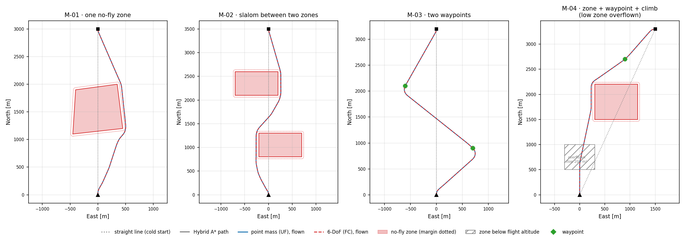
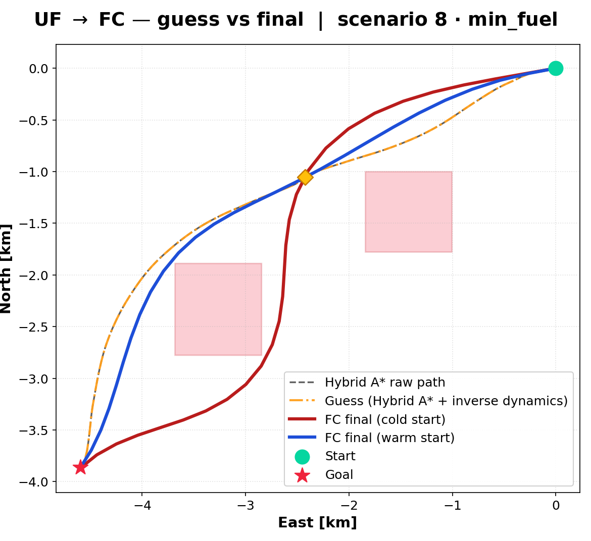
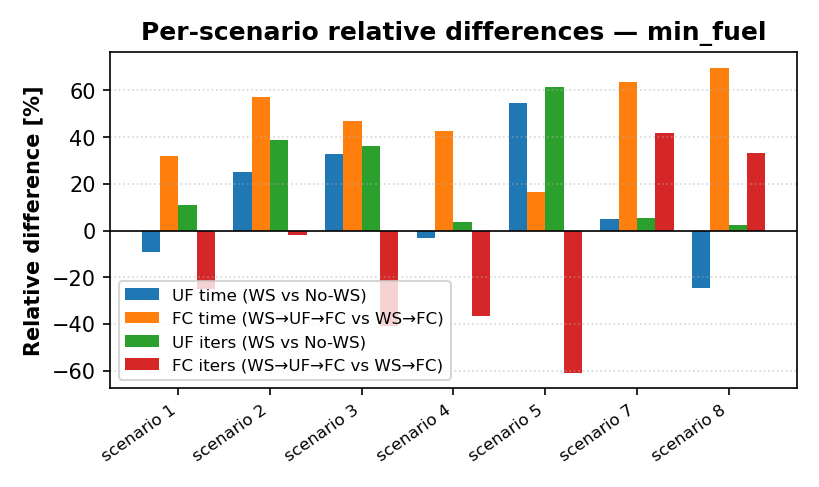
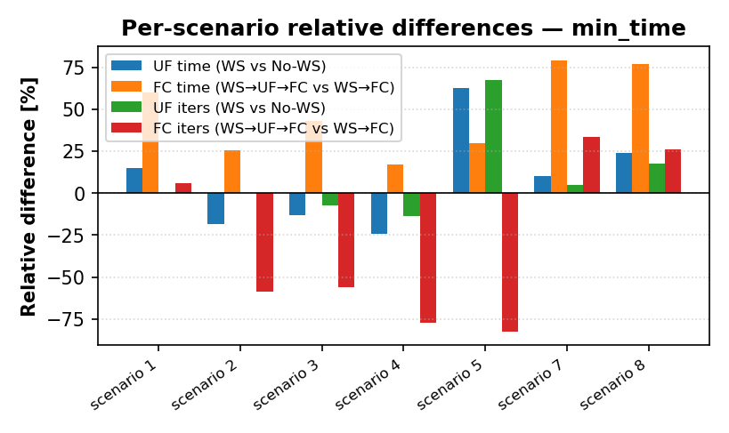

# ✈️ Optimal 3D Trajectory Planning for a Fixed-Wing UAV


[](https://github.com/pablourioste/uavtraj-opt/actions/workflows/code.yml)

<p align="center">
  
</p>
<p align="center"><sub>Four missions planned around no-fly zones and through waypoints, then flown by a point-mass and a 6-DoF model of a generic UAV, using the public code in this repository. The dotted straight line is what a cold start would try: it crosses the zones.</sub></p>

> Bachelor's thesis (Universitat Politècnica de Catalunya – ESEIAAT) developed with **CIMNE** and in collaboration with **Singular Aircraft**.
> Minimum-time / minimum-fuel 3D trajectory optimisation for a fixed-wing UAV, accelerated by a Hybrid A\* warm start.

## Missions around no-fly zones

The cover shows the front end of the method: a Hybrid A\* planner finds a flyable path around the active no-fly zones and through the waypoints, and both aircraft models fly it in closed loop. All four missions use a generic UAV at 25 m/s with 30° of bank, which gives a planning turn radius of 143 m.

| Mission | Setting | Planned path | Flight time UF / FC | Clearance beyond the 40 m margin | Waypoint miss | Straight-line cold start |
|---|---|---:|---:|---:|---:|---|
| M-01 | One no-fly zone on the direct route | 3.20 km | 128.0 / 128.0 s | 11 / 11 m | – | 394 m inside the zone |
| M-02 | Slalom between two zones | 3.75 km | 150.0 / 149.9 s | 12 / 12 m | – | 200 m inside a zone |
| M-03 | Two waypoints | 4.31 km | 172.4 / 172.2 s | – | 1.1 / 1.0 m | – |
| M-04 | Zone + waypoint + 150 m climb; a low zone is overflown | 3.92 km | 159.3 / 157.8 s | 16 / 16 m | 0.8 / 0.7 m | 316 m inside the zone |

- **Every mission is flown clear of every zone.** Both models stay outside each zone's margin, and every waypoint is passed well inside its 40 m tolerance.
- **The cold start would be infeasible.** A straight line between the same end points runs 200–394 m deep into a zone. This is why the thesis's cold-start solver failed in its no-fly-zone and waypoint scenarios.
- **Altitude bands are respected.** In M-04, a zone that tops out at 200 m is legitimately overflown while the aircraft climbs from 300 m.

```bash
cd code && bash run.sh                                       # build, 25 tests, all 7 use cases, figures
./build/ofc data/cases/uc07_nfz_missions.json                # just these missions   (Windows: .\run.ps1)
```

These trajectories are flyable reference paths, the kind of warm start the thesis hands to its optimiser. They are not optimal trajectories: the optimiser itself is not part of the public code. Full walk-through: [Worked examples → UC-07](docs/code/examples.md#uc-07--missions-with-no-fly-zones-and-waypoints).

> [!IMPORTANT]
> **Why the full solver code is not in this repository.** This work was designed exclusively as a product for [Singular Aircraft](https://singularaircraft.com/inicio). For privacy and confidentiality reasons towards the company, the complete software repository cannot be shared. What **can** be shared is the knowledge behind it: the research, the mathematical methods (formulations, constraints, cost functions, warm-start strategy) and how they are applied in code. That is what this repository contains, plus a **restricted, clean-room public edition of the code** in [`code/`](code/). It was rewritten from the thesis equations and uses a generic aircraft. It leaves out the optimiser and the production-only features (terrain, geofences, real aircraft data).

📄 **Full thesis (PDF):** [`thesis/Optimal_3D_Trajectory_Planning_Thesis_Urioste.pdf`](thesis/Optimal_3D_Trajectory_Planning_Thesis_Urioste.pdf)

## Deeper results

Below, from the missions above down to the thesis benchmark and the aircraft's design charts.

### 1. Inside one mission

<p align="center">
  
</p>

M-04 in detail. Top view, then altitude (a 150 m climb), bank, and distance to the no-fly zones along the path, for the point-mass model (blue) and the 6-DoF model (red dashed). The clearance is smallest at the zone's corner, where it is still 16 m beyond the margin.

<p align="center">
  
</p>

M-02 weaves between two zones that block opposite sides of the direct route. The clearance comes within 12 m of the margin once per zone, and never closer.

### 2. The thesis solver: what the warm start buys

The thesis applies the same idea to the real aircraft, the amphibious heavy UAV **Flyox I** (Singular Aircraft):

- **Problem.** Compute flyable, energy-efficient 3D trajectories (climb, cruise, descent) that respect terrain (DEM), no-fly zones, waypoints and the flight envelope.
- **Method.** Optimal control problem → trapezoidal **direct collocation** → large sparse NLP solved with **IPOPT**, in two fidelity levels (point-mass *UF*, 6-DoF rigid body *FC*), seeded by a **Hybrid A\* → inverse dynamics → UF → FC** warm-start chain.
- **Result.** Without a warm start the point-mass solver is infeasible in 3 of 8 scenarios. With the full chain, **all 8 converge**, and the 6-DoF stage is up to **4.4× faster** than seeding it directly from the geometric guess.


<p align="center">
  
</p>
<p align="center"><sub>Thesis scenario 8 (no-fly zones + waypoint), minimum fuel: Hybrid A* path, warm-start guess, and the optimal 6-DoF trajectories from a direct seed and from the full warm-start chain.</sub></p>

| Result | Value |
|---|---|
| FC, full pipeline (`WS→UF→FC`) vs direct seed (`WS→FC`) | Faster in **7/7** converged scenarios, both objectives |
| Best FC speed-up, scenario 8 (NFZ + waypoints), min-fuel | 48.8 s → 11.1 s (**≈ 4.4×**) |
| Best FC speed-up, scenario 8, min-time | 41.4 s → 10.8 s (**≈ 3.8×**) |
| UF without warm start | **Infeasible in 3/8** (NFZ and waypoint scenarios) |
| UF with warm start | Converges **8/8**, in 0.5 – 3.0 s (meets the 4 s target) |
| `WS→FC` in scenario 7 | Times out (> 60 s); `WS→UF→FC` solves it in ≈ 11.9 s |
| Cost of the warm start | Hybrid A\* 40–220 ms + inverse dynamics 2–25 ms |

All timings come from the **v1 solver, which built its Jacobians by finite differences**. A later version uses exact derivatives (automatic differentiation); preliminary measurements show the point-mass stage about 3× faster. See [Derivatives: v1 and v2](docs/derivatives.md).

**Honest limitations.** In these numbers the 6-DoF (FC) stage takes 4.5 – 12.9 s even with a warm start, so it does **not** meet the < 4 s real-time goal; only the point-mass (UF) layer does. For the point-mass stage the warm start is not always faster in the easy empty-airspace cases (it was faster in 3/5 min-fuel and 1/5 min-time cases); its real value is **robustness**.

<p align="center">
  
  
</p>

### 3. Conclusions of the thesis

**What the work shows**

1. **A cold start is not viable for constrained missions.** The point-mass solver fails in 3 of 8 scenarios (those with no-fly zones or waypoints) when started from a straight-line guess.
2. **The hierarchical warm start makes the solver robust.** The chain Hybrid A\* → inverse dynamics → UF → FC converged in all 8 scenarios, for both objectives. One scenario (waypoints only) was solved only with the full chain.
3. **It also makes the 6-DoF stage faster.** Against seeding FC directly, it was faster in every scenario where both converged: 1.2× to 4.4× for the 6-DoF stage, with a mean saving of 8.7–11.9 s. The warm-start cost is small (about 40–220 ms for Hybrid A\* and 2–25 ms for inverse dynamics).
4. **Both pipelines reach nearly the same optimum** (3.3–4.5 % trajectory deviation, end-mass differences ≤ 0.1 kg), so the speed-up does not come from a worse solution. In scenario 8 the warm-started point-mass solve even finds a better optimum (101.5 s against 109.5 s in minimum time).
5. **Smoothness regularisation makes controls flyable, at a price.** It suppresses control chatter in both models, but for the 6-DoF model it moves the optimum noticeably (SC-01 min-fuel: without regularisation the flight is 21 % longer and uses 14 % less energy), whereas the point-mass model changes by only a few percent.

**What it does not show (yet)**

- **Real-time target:** with the v1 solver only the point-mass layer (0.5–3.0 s) meets the < 4 s goal; the 6-DoF stage takes 4.5–12.9 s even with a warm start. End-to-end timings of the exact-derivative version are not part of this benchmark.
- For easy empty-airspace cases the warm start does not always save time on the point-mass stage; its value there is robustness, not speed.
- Open-loop planning only, deterministic wind, one aircraft model, 8 scenarios with 2 repetitions on one machine, local optima only.

**Next steps:** re-run the benchmark with the exact-derivative version against the < 4 s target for the 6-DoF stage, closed-loop MPC around the offline trajectory, stochastic wind with chance constraints.

Details: [Conclusions](docs/15-conclusions.md) · [Benchmark](docs/14-results-warmstart.md).

### 4. The aircraft and the formulation in the public code

[`code/`](code/) is a C++17 implementation with no external dependencies. It contains:

- a generic aircraft defined in JSON (design parameters and aerodynamic coefficients);
- the point-mass (UF) and 6-DoF (FC) models;
- trapezoidal collocation with a sparse analytic Jacobian, envelope, boundary and no-fly-zone constraints, and the time–fuel cost;
- trim, simulation and the aircraft's design charts;
- four typical design scenarios and the four missions above.

<p align="center">
  
</p>

| Example | Result with the generic UAV |
|---|---|
| Missions with NFZs and waypoints (UC-07) | Hybrid A\* plans around the zones in 0.01–2 s (machine-dependent); UF and FC stay 11–16 m outside every margin and pass within 1.1 m of each waypoint, while the straight-line cold start runs 200–394 m into the zones |
| Design scenarios SC-00…SC-03 (UC-06) | UF and FC agree to within 0.2–67 m with the same fuel; climbs are power-limited; least fuel at 22 m/s, next to best L/D |
| Design charts (UC-05) | V_stall 15.1 m/s, best L/D at 20.8 m/s, V_max 36.9 m/s, service ceiling 5.9 km; elevator authority (not stall) sets the minimum trimmed speed |
| Transcription check (UC-04) | analytic sparse Jacobian 57–487× faster than finite differences (O(N) against O(N²)), agreeing to 1e-10 |

<p align="center">
  
</p>

Walk-through with every output and figure: [Worked examples and design scenarios](docs/code/examples.md).

## Documentation

| Part | Pages |
|---|---|
| Project | [Problem](docs/01-problem.md) · [State of the art](docs/02-state-of-the-art.md) · [Methodology](docs/03-methodology.md) · [Design decisions](docs/04-design-decisions.md) |
| Theory | [OCP → NLP](docs/05-ocp-theory.md) · [UF dynamics](docs/06-dynamics-uf.md) · [FC dynamics](docs/07-dynamics-fc.md) · [Transcription](docs/08-transcription.md) · [Constraints](docs/09-constraints.md) · [Cost function](docs/10-cost-function.md) · [Warm start](docs/11-warm-start.md) |
| Results | [Validation](docs/12-results-validation.md) · [Regularisation](docs/13-results-penalties.md) · [Warm-start benchmark](docs/14-results-warmstart.md) · [Derivatives: v1 and v2](docs/derivatives.md) · [Conclusions](docs/15-conclusions.md) |
| Code | [Overview](docs/code/index.md) · [Architecture](docs/code/architecture.md) · [Formulation in code](docs/code/formulation.md) · [Use cases](docs/code/use-cases.md) · [Worked examples](docs/code/examples.md) · [Aircraft format](docs/code/aircraft-format.md) |
| Appendix | [Coordinate frames](docs/appendix-frames.md) · [Adjoint method](docs/appendix-adjoint.md) · [Aircraft MSN012](docs/appendix-msn012.md) · [References](docs/references.md) |

Browse locally with `pip install mkdocs-material && mkdocs serve`, or online at [pablourioste.github.io/uavtraj-opt](https://pablourioste.github.io/uavtraj-opt/).

## Repository layout

```
├── thesis/        full thesis (PDF)
├── docs/          chapter-by-chapter write-up (MkDocs) + figures in docs/assets/
│   └── code/      documentation of the public code edition
├── code/          public C++17 edition: generic aircraft, models, formulation, planner, examples
└── results/       aggregated benchmark table (CSV) + column dictionary
```

## Tech stack

Thesis solver: Python · CasADi · IPOPT (MA57 / MUMPS) · C++17 (production port) · Linux.
Public edition: C++17 · CMake · nlohmann/json · Python + Matplotlib for the figures. Documentation: MkDocs.

## About the code

The production solver was designed exclusively as a product for **Singular Aircraft** and, for privacy reasons towards the company, it is **not** part of this repository. This repo shares the **knowledge**: the research, the mathematical methods and their application in code, documented through equations, diagrams, pseudocode, figures and results. On top of that it includes [`code/`](code/), a restricted public edition written from scratch from the thesis equations, with a generic aircraft and runnable examples. Its [scope](docs/code/index.md#scope) lists what is and is not included.

## Author & citation

**Pablo Urioste Alarcón** — [LinkedIn](https://www.linkedin.com/in/pablo-urioste-alarcón-239804235) — supervised by Dr. Àlex Ferrer Ferré (CIMNE / UPC).
Cite via [`CITATION.cff`](CITATION.cff). Documentation and figures: CC BY 4.0 ([LICENSE](LICENSE)); code in `code/`: MIT ([LICENSE-CODE](LICENSE-CODE)). Exclusions and trademarks: [NOTICE.md](NOTICE.md).
