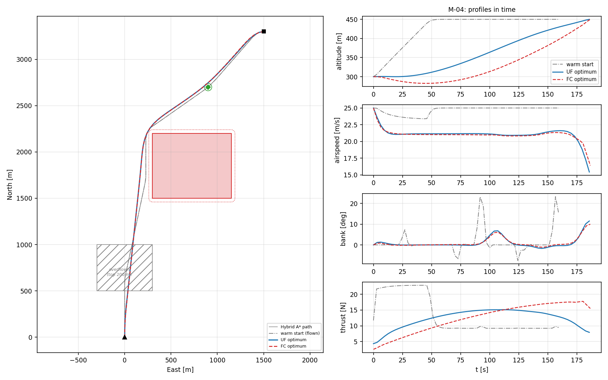
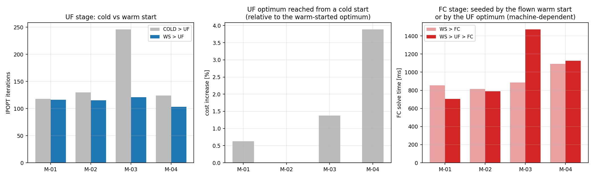

# ✈️ Optimal 3D Trajectory Planning for a Fixed-Wing UAV


[](https://github.com/pablourioste/uavtraj-opt/actions/workflows/code.yml)

<p align="center">
  
</p>
<p align="center"><sub>Four minimum-fuel missions of a generic UAV, optimised with IPOPT by the public code in this repository: a Hybrid A* path flown by guidance laws (grey) seeds the point-mass optimum (blue), which seeds the 6-DoF optimum (red dashed).</sub></p>

> Bachelor's thesis (Universitat Politècnica de Catalunya – ESEIAAT) developed with **CIMNE** and in collaboration with **Singular Aircraft**.
> Minimum-time / minimum-fuel 3D trajectory optimisation for a fixed-wing UAV, accelerated by a Hybrid A\* warm start.

## Optimal missions around no-fly zones

The cover runs the whole method end to end on a generic UAV:

1. A **Hybrid A\*** planner finds a flyable path around the active no-fly zones and through the waypoints, and guidance laws fly it with both aircraft models.
2. That flown trajectory seeds the **point-mass (UF) optimal-control problem**, solved with **IPOPT**.
3. The UF optimum is projected to 6-DoF states and controls and seeds the **rigid-body (FC) problem**, solved with IPOPT.
4. Every optimum is re-checked against all its constraints and bounds outside the solver.

| Mission | Setting | Optimal path | Flight time UF / FC | Fuel UF / FC | Clearance beyond the 40 m margin | Waypoint miss (tolerance 40 m) | IPOPT iterations UF / FC |
|---|---|---:|---:|---:|---:|---:|---:|
| M-01 | One no-fly zone on the direct route | 3.20 km | 152.3 / 152.5 s | 6.21 / 6.21 g | 9 / 9 m | – | 116 / 85 |
| M-02 | Slalom between two zones | 3.75 km | 178.4 / 178.7 s | 7.36 / 7.36 g | 11 / 11 m | – | 115 / 90 |
| M-03 | Two waypoints | 4.15 km | 199.1 / 199.2 s | 8.25 / 8.26 g | – | 40 / 40 m | 121 / 193 |
| M-04 | Zone + waypoint + 150 m climb; a low zone is overflown | 3.91 km | 185.8 / 186.6 s | 11.55 / 11.54 g | 12 / 12 m | 35 / 35 m | 103 / 131 |

- **Every stage converges and passes the independent verification**: dynamics, boundary conditions, envelope, zones and bounds.
- **The whole optimal path stays clear of every zone.** The clearance is measured along the segments between nodes, not only at the nodes.
- **Both models agree.** Point-mass and 6-DoF optima differ by under 0.5 % in flight time and 0.2 % in fuel, as they should for the same aircraft, provided the 6-DoF model flies coordinated (see [Worked examples → UC-08](docs/code/examples.md#uc-08--optimal-missions)).
- **Minimum fuel is physically sensible.** The aircraft slows from 25 m/s to about 21 m/s, its best lift-to-drag speed, and bleeds speed before arrival. It passes the waypoints on their tolerance circle, because going closer costs fuel.
- **Each stage solves in about 0.5–1.5 s** on a laptop with 60 nodes (machine-dependent).

```bash
sudo apt install coinor-libipopt-dev pkg-config              # IPOPT (Linux / WSL); optional
cd code && bash run.sh                                       # build, tests, all 9 use cases, figures
./build/ofc data/cases/uc08_optimal_missions.json            # just these missions
```

On Windows PowerShell, `.\utils\install_ipopt.ps1` installs the official IPOPT binaries once, and `.\run.ps1` then builds with Visual Studio. Without IPOPT, everything else still builds and runs, and the two optimisation use cases are skipped. Iteration counts in the table are from IPOPT 3.11.9 on Linux; 3.14 on Windows reaches the same optima in slightly different counts.

> [!IMPORTANT]
> **What the code in this repository is.** The thesis solver was designed exclusively as a product for [Singular Aircraft](https://singularaircraft.com/inicio). For privacy and confidentiality reasons towards the company, its software repository is not shared, and nothing from it is here. What this repository shares is the knowledge behind it (research, formulations, constraints, cost functions, warm-start strategy) and a **clean-room implementation** in [`code/`](code/). That implementation was written from the thesis equations, with its own structure, naming and settings, and a generic aircraft built from public data. It includes its own optimiser: collocation problems for both models, solved with IPOPT. Production-only features (terrain, geofences, real aircraft data, mission formats, autopilot export) are not included.

📄 **Full thesis (PDF):** [`thesis/Optimal_3D_Trajectory_Planning_Thesis_Urioste.pdf`](thesis/Optimal_3D_Trajectory_Planning_Thesis_Urioste.pdf)

## Deeper results

Below, from the missions above down to the thesis benchmark and the aircraft's design charts.

### 1. Inside one mission

<p align="center">
  
</p>

M-04 in detail. The warm start (grey) climbs at once and cruises at the commanded 25 m/s. Both optima instead slow to about 21 m/s, spread the 150 m climb over the whole flight with a smooth thrust profile, and cut closer to the zone's corner than the planner's path. The two models time the climb differently but burn the same fuel: for this propulsion model the optimum is flat in when the climb happens.

<p align="center">
  
</p>

The same missions solved by different pipelines, on identical problems (UC-09):

- **Warm vs cold start.** From a straight-line cold start the point-mass problem still converges for this small aircraft, unlike in the thesis. But it needs up to twice the iterations, and in M-04 it ends in a worse local optimum: 195 s and 11.96 g against 186 s and 11.55 g.
- **Seeding the 6-DoF stage.** Seeding FC with the UF optimum, or directly with the 6-DoF trajectory flown by the autopilot, reaches the same optimum. The time difference is mixed here, because the flown 6-DoF trajectory is already a much better seed than the thesis's inverse-dynamics guess.

### 2. The thesis solver: what the warm start buys

The thesis applies the same idea to the real aircraft, the amphibious heavy UAV **Flyox I** (Singular Aircraft):

- **Problem.** Compute flyable, energy-efficient 3D trajectories (climb, cruise, descent) that respect terrain (DEM), no-fly zones, waypoints and the flight envelope.
- **Method.** Optimal control problem → trapezoidal **direct collocation** → large sparse NLP solved with **IPOPT**, in two fidelity levels (point-mass *UF*, 6-DoF rigid body *FC*), seeded by a **Hybrid A\* → inverse dynamics → UF → FC** warm-start chain.
- **Result.** Without a warm start the point-mass solver is infeasible in 3 of 8 scenarios. With the full chain, **all 8 converge**, and the 6-DoF stage is up to **4.4× faster** than seeding it directly from the geometric guess.


<p align="center">
  
</p>
<p align="center"><sub>Thesis scenario 8 (no-fly zones + waypoint), minimum fuel: Hybrid A* path, warm-start guess, and the optimal 6-DoF trajectories from a direct seed and from the full warm-start chain.</sub></p>

| Result | Value |
|---|---|
| FC, full pipeline (`WS→UF→FC`) vs direct seed (`WS→FC`) | Faster in **7/7** converged scenarios, both objectives |
| Best FC speed-up, scenario 8 (NFZ + waypoints), min-fuel | 48.8 s → 11.1 s (**≈ 4.4×**) |
| Best FC speed-up, scenario 8, min-time | 41.4 s → 10.8 s (**≈ 3.8×**) |
| UF without warm start | **Infeasible in 3/8** (NFZ and waypoint scenarios) |
| UF with warm start | Converges **8/8**, in 0.5 – 3.0 s (meets the 4 s target) |
| `WS→FC` in scenario 7 | Times out (> 60 s); `WS→UF→FC` solves it in ≈ 11.9 s |
| Cost of the warm start | Hybrid A\* 40–220 ms + inverse dynamics 2–25 ms |

All timings come from the **v1 solver, which built its Jacobians by finite differences**. A later version uses exact derivatives (automatic differentiation); preliminary measurements show the point-mass stage about 3× faster. See [Derivatives: v1 and v2](docs/derivatives.md).

**Honest limitations.** In these numbers the 6-DoF (FC) stage takes 4.5 – 12.9 s even with a warm start, so it does **not** meet the < 4 s real-time goal; only the point-mass (UF) layer does. For the point-mass stage the warm start is not always faster in the easy empty-airspace cases (it was faster in 3/5 min-fuel and 1/5 min-time cases); its real value is **robustness**.

<p align="center">
  
  
</p>

### 3. Conclusions of the thesis

**What the work shows**

1. **A cold start is not viable for constrained missions.** The point-mass solver fails in 3 of 8 scenarios (those with no-fly zones or waypoints) when started from a straight-line guess.
2. **The hierarchical warm start makes the solver robust.** The chain Hybrid A\* → inverse dynamics → UF → FC converged in all 8 scenarios, for both objectives. One scenario (waypoints only) was solved only with the full chain.
3. **It also makes the 6-DoF stage faster.** Against seeding FC directly, it was faster in every scenario where both converged: 1.2× to 4.4× for the 6-DoF stage, with a mean saving of 8.7–11.9 s. The warm-start cost is small (about 40–220 ms for Hybrid A\* and 2–25 ms for inverse dynamics).
4. **Both pipelines reach nearly the same optimum** (3.3–4.5 % trajectory deviation, end-mass differences ≤ 0.1 kg), so the speed-up does not come from a worse solution. In scenario 8 the warm-started point-mass solve even finds a better optimum (101.5 s against 109.5 s in minimum time).
5. **Smoothness regularisation makes controls flyable, at a price.** It suppresses control chatter in both models, but for the 6-DoF model it moves the optimum noticeably (SC-01 min-fuel: without regularisation the flight is 21 % longer and uses 14 % less energy), whereas the point-mass model changes by only a few percent.

**What it does not show (yet)**

- **Real-time target:** with the v1 solver only the point-mass layer (0.5–3.0 s) meets the < 4 s goal; the 6-DoF stage takes 4.5–12.9 s even with a warm start. End-to-end timings of the exact-derivative version are not part of this benchmark.
- For easy empty-airspace cases the warm start does not always save time on the point-mass stage; its value there is robustness, not speed.
- Open-loop planning only, deterministic wind, one aircraft model, 8 scenarios with 2 repetitions on one machine, local optima only.

**Next steps:** re-run the benchmark with the exact-derivative version against the < 4 s target for the 6-DoF stage, closed-loop MPC around the offline trajectory, stochastic wind with chance constraints.

Details: [Conclusions](docs/15-conclusions.md) · [Benchmark](docs/14-results-warmstart.md).

### 4. The aircraft and the formulation in the public code

[`code/`](code/) is a C++17 implementation; IPOPT is its only optional dependency. It contains:

- a generic aircraft defined in JSON (design parameters and aerodynamic coefficients);
- the point-mass (UF) and 6-DoF (FC) models;
- trapezoidal collocation with a sparse constraint Jacobian; envelope, boundary, no-fly-zone and waypoint constraints; and the time–fuel cost with smoothness regularisation;
- a warm-start chain (Hybrid A\* → guidance laws → UF → FC projection) and a staged optimisation pipeline with IPOPT and independent verification;
- trim, simulation, the aircraft's design charts, four typical design scenarios, the four missions above and a warm-start benchmark.

<p align="center">
  
</p>

| Example | Result with the generic UAV |
|---|---|
| Optimal missions (UC-08) | WS → UF → FC converges in all four missions, 0.5–1.5 s per stage; UF and FC optima agree to 0.2 % in fuel; 9–12 m beyond every margin along the whole path |
| Warm-start benchmark (UC-09) | cold starts converge but need up to 2× the iterations and can end in worse local optima (+3.9 % cost in M-04) |
| Missions with NFZs and waypoints (UC-07) | Hybrid A\* plans around the zones in 0.01–2 s (machine-dependent); UF and FC stay 11–16 m outside every margin and pass within 1.1 m of each waypoint, while the straight-line cold start runs 200–394 m into the zones |
| Design scenarios SC-00…SC-03 (UC-06) | UF and FC agree to within 0.2–67 m with the same fuel; climbs are power-limited; least fuel at 22 m/s, next to best L/D |
| Design charts (UC-05) | V_stall 15.1 m/s, best L/D at 20.8 m/s, V_max 36.9 m/s, service ceiling 5.9 km; elevator authority (not stall) sets the minimum trimmed speed |
| Transcription check (UC-04) | analytic sparse Jacobian 57–487× faster than finite differences (O(N) against O(N²)), agreeing to 1e-10 |

<p align="center">
  
</p>

Walk-through with every output and figure: [Worked examples and design scenarios](docs/code/examples.md).

## Run it with your own aircraft and mission

From scratch, in four steps (full guide: [code/README.md](code/README.md#run-your-own-aircraft-and-mission)):

1. **Build.** You need CMake ≥ 3.14 and a C++17 compiler; for the optimiser, also IPOPT (`sudo apt install coinor-libipopt-dev pkg-config` on Linux / WSL). Run `cd code && bash run.sh -t` to build and run the tests; `./build/ofc --info` says whether the optimiser is in.
2. **Describe your aircraft.** Copy `code/data/aircraft/generic_uav.json` to `my_uav.json` and enter its mass, geometry, inertia, propulsion, envelope, actuator limits and aerodynamic derivatives. The loader rejects missing or inconsistent values. [UC-01](code/data/cases/uc01_aircraft_report.json) and [UC-05](code/data/cases/uc05_design_charts.json) print its performance and design charts.
3. **Write the mission and the optimisation settings.** Copy [uc08_optimal_missions.json](code/data/cases/uc08_optimal_missions.json). For each mission give the start and end poses, altitude, climb and speed, no-fly zones (polygon `[north, east]` in metres, altitude band, margin) and waypoints (position, tolerance). The `pipeline` block sets the objective (minimum time … minimum fuel), the nodes, the stages, the smoothing weights and the IPOPT options.
4. **Run.** `./build/ofc data/cases/my_mission.json`, then `python utils/plot_results.py`. You get the warm start, the UF and FC optima, a verification report per stage, CSV files and figures.

| Where is… | File |
|---|---|
| the dynamics | [point_mass.cpp](code/src/model/point_mass.cpp) (UF, with analytic Jacobian), [rigid_body.cpp](code/src/model/rigid_body.cpp) (FC) |
| the optimal-control problems | [ocp_problem.cpp](code/src/formulation/ocp_problem.cpp) (constraint vector and sparse Jacobian), [ocp_uf.cpp](code/src/formulation/ocp_uf.cpp), [ocp_fc.cpp](code/src/formulation/ocp_fc.cpp), [collocation.cpp](code/src/formulation/collocation.cpp) (defects) |
| the IPOPT call | `nlp::solve` in [ipopt_solver.cpp](code/src/solver/ipopt_solver.cpp) |
| the sequence of the optimisation | `pipeline::run` in [pipeline.cpp](code/src/pipeline/pipeline.cpp) |
| the warm start | [warm_start.cpp](code/src/warmstart/warm_start.cpp), [planner.cpp](code/src/planning/planner.cpp) |

How to add new kinds of environment constraints: [Inserting environment constraints](code/README.md#inserting-environment-constraints).

## Documentation

| Part | Pages |
|---|---|
| Project | [Problem](docs/01-problem.md) · [State of the art](docs/02-state-of-the-art.md) · [Methodology](docs/03-methodology.md) · [Design decisions](docs/04-design-decisions.md) |
| Theory | [OCP → NLP](docs/05-ocp-theory.md) · [UF dynamics](docs/06-dynamics-uf.md) · [FC dynamics](docs/07-dynamics-fc.md) · [Transcription](docs/08-transcription.md) · [Constraints](docs/09-constraints.md) · [Cost function](docs/10-cost-function.md) · [Warm start](docs/11-warm-start.md) |
| Results | [Validation](docs/12-results-validation.md) · [Regularisation](docs/13-results-penalties.md) · [Warm-start benchmark](docs/14-results-warmstart.md) · [Derivatives: v1 and v2](docs/derivatives.md) · [Conclusions](docs/15-conclusions.md) |
| Code | [Overview](docs/code/index.md) · [Architecture](docs/code/architecture.md) · [Formulation in code](docs/code/formulation.md) · [Use cases](docs/code/use-cases.md) · [Worked examples](docs/code/examples.md) · [Aircraft format](docs/code/aircraft-format.md) |
| Appendix | [Coordinate frames](docs/appendix-frames.md) · [Adjoint method](docs/appendix-adjoint.md) · [Aircraft MSN012](docs/appendix-msn012.md) · [References](docs/references.md) |

Browse locally with `pip install mkdocs-material && mkdocs serve`, or online at [pablourioste.github.io/uavtraj-opt](https://pablourioste.github.io/uavtraj-opt/).

## Repository layout

```
├── thesis/        full thesis (PDF)
├── docs/          chapter-by-chapter write-up (MkDocs) + figures in docs/assets/
│   └── code/      documentation of the public code edition
├── code/          C++17 implementation: generic aircraft, models, planner, optimisation (IPOPT), examples
└── results/       aggregated benchmark table (CSV) + column dictionary
```

## Tech stack

Thesis solver: Python · CasADi · IPOPT (MA57 / MUMPS) · C++17 (production port) · Linux.
Public code: C++17 · CMake · IPOPT (optional, via pkg-config) · nlohmann/json · Python + Matplotlib for the figures. Documentation: MkDocs.

## About the code

The production solver was designed exclusively as a product for **Singular Aircraft** and, for privacy reasons towards the company, it is **not** part of this repository. This repo shares the **knowledge**: the research, the mathematical methods and their application in code, documented through equations, diagrams, pseudocode, figures and results. On top of that it includes [`code/`](code/), an independent implementation written from scratch from the thesis equations, with a generic aircraft, its own optimisation pipeline and runnable examples. Its [scope](docs/code/index.md#scope) lists what is and is not included.

## Author & citation

**Pablo Urioste Alarcón** — [LinkedIn](https://www.linkedin.com/in/pablo-urioste-alarcón-239804235) — supervised by Dr. Àlex Ferrer Ferré (CIMNE / UPC).
Cite via [`CITATION.cff`](CITATION.cff). Documentation and figures: CC BY 4.0 ([LICENSE](LICENSE)); code in `code/`: MIT ([LICENSE-CODE](LICENSE-CODE)). Exclusions and trademarks: [NOTICE.md](NOTICE.md).
