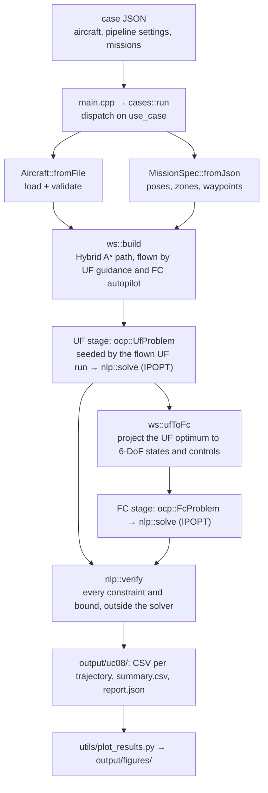

# code/ — trajectory optimisation for a generic fixed-wing UAV

A C++17 implementation, written from the thesis equations, of the whole method:

- a **generic aircraft** described in JSON;
- the point-mass (UF) and 6-DoF (FC) models;
- trapezoidal direct collocation, with a sparse constraint Jacobian, envelope, boundary, no-fly-zone and waypoint constraints, and a time–fuel cost with smoothness regularisation;
- a **warm start**: a Hybrid A\* path around the no-fly zones, flown by guidance laws, and a UF → FC projection;
- **optimisation with IPOPT** in two stages, UF then FC, each verified independently of the solver;
- trim, simulation, design charts, design scenarios and a warm-start benchmark.

Everything except the optimisation step builds with no dependencies beyond the standard library and the bundled `nlohmann/json`. IPOPT is optional: CMake links it when it finds it, and without it the optimisation use cases are skipped.

## Build

```bash
bash run.sh        # build, tests, all use cases, figures in output/figures/
bash run.sh -t     # build and tests only
.\run.ps1          # same on Windows PowerShell
```

**With the optimiser.** Install IPOPT and `pkg-config`, then build as above; CMake prints `IPOPT x.y.z: trajectory optimisation enabled`.

| System | Install |
|---|---|
| Ubuntu / Debian / WSL | `sudo apt install coinor-libipopt-dev pkg-config` |
| macOS (Homebrew) | `brew install ipopt pkg-config` |
| Windows (PowerShell) | `.\utils\install_ipopt.ps1` (official COIN-OR binaries, sets `IPOPT_DIR`); needs Visual Studio 2022+ with the C++ tools, which `run.ps1` then uses |

`-DOFC_IPOPT=ON` makes IPOPT required (the build fails if it is missing); `-DOFC_IPOPT=OFF` never links it. Without pkg-config, CMake looks in `IPOPT_DIR` (a folder with `include/`, `lib/`, `bin/`) and copies its DLLs next to the executables. `./build/ofc --info` (Windows: `.\build\Release\ofc.exe --info`) tells whether a build has the optimiser.

On Windows, from `code/`:

```powershell
.\utils\install_ipopt.ps1     # once: downloads IPOPT 3.14.20 to %LOCALAPPDATA%\Programs, sets IPOPT_DIR
.\run.ps1                     # Visual Studio build, tests, all 9 use cases, figures
.\build\Release\ofc.exe data\cases\uc08_optimal_missions.json
```

## Use cases

| Use case | Case file | Needs IPOPT |
|---|---|:---:|
| UC-01 Aircraft report | `data/cases/uc01_aircraft_report.json` | |
| UC-02 Trim (UF and FC) | `data/cases/uc02_trim.json` | |
| UC-03 Open-loop simulation | `data/cases/uc03_simulation.json` | |
| UC-04 Transcription check | `data/cases/uc04_transcription.json` | |
| UC-05 Design charts | `data/cases/uc05_design_charts.json` | |
| UC-06 Typical design scenarios | `data/cases/uc06_design_scenarios.json` | |
| UC-07 Missions with no-fly zones and waypoints (planner + guidance) | `data/cases/uc07_nfz_missions.json` | |
| **UC-08 Optimal missions** (warm start → UF → FC) | `data/cases/uc08_optimal_missions.json` | ✓ |
| **UC-09 Warm-start benchmark** (cold vs warm, direct FC vs UF → FC) | `data/cases/uc09_warmstart_benchmark.json` | ✓ |

## Code structure

```
code/
├── include/ofc/            one header per module (public API)
├── src/
│   ├── main.cpp            entry point: arguments → run each case → timing summary
│   ├── app/                use cases (UC-01…09), JSON input, CSV/JSON output
│   ├── model/              atmosphere, aircraft, performance, point mass, rigid body, environment
│   ├── numerics/           finite differences, Newton, RK4, trim
│   ├── planning/           Dubins paths, Hybrid A*, multi-leg mission planning
│   ├── scenarios/          mission description, guidance laws (UF dynamic inversion, FC autopilot)
│   ├── warmstart/          planner + guidance → initial points; UF → FC projection
│   ├── formulation/        trapezoidal collocation, UF and FC optimal-control problems
│   ├── solver/             generic NLP interface, verification, IPOPT adapter
│   └── pipeline/           staged optimisation of one mission
├── data/aircraft/          aircraft files
├── data/cases/             one JSON file per use case
├── tests/                  unit tests (no framework)
└── utils/plot_results.py   figures from the CSV outputs
```

| Module | Header | Responsibility |
|---|---|---|
| Aircraft and models | `aircraft.hpp`, `atmosphere.hpp`, `point_mass.hpp`, `rigid_body.hpp` | Data, ISA, the UF and FC right-hand sides; analytic UF Jacobian |
| Environment | `environment.hpp` | No-fly zones (polygon, altitude band, margin, signed distance), waypoints |
| Mission | `mission.hpp` | `MissionSpec`: start and goal poses, climb, speed, zones and waypoints, from JSON |
| Collocation | `collocation.hpp` | Decision-vector layout, pack/unpack, trapezoidal defects and their block-banded Jacobian |
| NLP | `nlp.hpp` | `nlp::Problem` (cost, gradient, constraints, sparse Jacobian, bounds, labels) and `nlp::verify` |
| Optimal-control problems | `ocp_problem.hpp`, `ocp_uf.hpp`, `ocp_fc.hpp` | `CollocationProblem` assembles bounds, boundary, path and waypoint rows; `UfProblem` and `FcProblem` add each model |
| Solver | `solver.hpp` | `nlp::solve`: IPOPT adapter with variable scaling, limited-memory Hessian, status mapping |
| Warm start | `planner.hpp`, `scenario.hpp`, `warm_start.hpp` | Hybrid A\*, guidance laws, resampling, cold starts, UF → FC projection |
| Pipeline | `pipeline.hpp` | Warm start → UF → FC → verification, with timings and per-stage reports |

## Workflow of an optimal mission (UC-08)



1. **Read the case and the aircraft.** `cases::run` picks the use case; `Aircraft::fromFile` rejects missing or inconsistent data.
2. **Warm start.** `ws::build` plans a path with Hybrid A\* (turn radius from the commanded speed and bank) and flies it with both models. The flown runs are dynamically consistent, so their collocation defects are small.
3. **UF stage.** The flown UF run is resampled on `nodes_uf` nodes and becomes the initial point of `UfProblem`; IPOPT solves it.
4. **FC stage.** The UF optimum is projected to rigid-body states and controls (`ws::ufToFc`) and seeds `FcProblem`. Without a UF stage (`WS>FC`), the run flown by the FC autopilot seeds it instead.
5. **Verification.** `nlp::verify` re-evaluates every constraint and bound of each optimum and names the worst row of each group (dynamics, boundary, envelope, environment, bounds). A stage is `ok` only if IPOPT converged **and** the verification passed.
6. **Export.** Trajectories (`<id>_ws.csv`, `<id>_uf.csv`, `<id>_fc.csv`), geometry, `summary.csv` and `report.json` with every stage's status, iterations, time and verification.

## Where things live

| Question | Answer |
|---|---|
| Dynamics | `uf::rhs` and `uf::jacobian` in [src/model/point_mass.cpp](src/model/point_mass.cpp); `fc::rhs` in [src/model/rigid_body.cpp](src/model/rigid_body.cpp) |
| Defects and their Jacobian | `ocp::trapezoidalDefects` and `ocp::trapezoidalJacobian` in [src/formulation/collocation.cpp](src/formulation/collocation.cpp). UF passes its analytic model Jacobians; FC passes central differences of `fc::rhs` (`FcProblem::modelJacobian`) |
| Full constraint vector and Jacobian | `CollocationProblem::constraints` and `constraintJacobian` in [src/formulation/ocp_problem.cpp](src/formulation/ocp_problem.cpp): defects, boundary rows, per-node path blocks, waypoint rows |
| Path constraints (envelope, zones) | UF: `TrapezoidalUF::pathAt` in [src/formulation/transcription.cpp](src/formulation/transcription.cpp). FC: `FcProblem::pathAt` in [src/formulation/ocp_fc.cpp](src/formulation/ocp_fc.cpp) |
| Cost | UF: `TrapezoidalUF::cost` / `costGradient`. FC: `FcProblem::cost` / `costGradient` |
| Bounds, scales, boundary conditions | The `UfProblem` and `FcProblem` constructors ([ocp_uf.cpp](src/formulation/ocp_uf.cpp), [ocp_fc.cpp](src/formulation/ocp_fc.cpp)) |
| **IPOPT call** | `nlp::solve` in [src/solver/ipopt_solver.cpp](src/solver/ipopt_solver.cpp): the `Adapter` class implements `Ipopt::TNLP` |
| Post-solve verification | `nlp::verify` in [src/solver/nlp.cpp](src/solver/nlp.cpp) |
| Sequence of the optimisation | `pipeline::run` in [src/pipeline/pipeline.cpp](src/pipeline/pipeline.cpp) |
| Warm start and UF → FC projection | [src/warmstart/warm_start.cpp](src/warmstart/warm_start.cpp) |

## The optimisation problem

Decision vector `z = [t_f | x_0 … x_{N-1} | u_0 … u_{N-1}]`, and constraints in this order:

| Block | Rows | Bounds | Notes |
|---|---|---|---|
| Defects | (N−1)·nx | = 0 | trapezoidal collocation, each row divided by a state scale |
| Boundary | nx + 4 | = 0 | whole initial state fixed; final position and heading |
| Path | nc per node | ≤ 0 | envelope rows and one `nfz:<id>` row per zone, normalised |
| Waypoints | 1 per waypoint | ≤ 0 | the waypoint's node lies within its tolerance |

- **UF** (8 states, 3 controls): stall, power, V_NE, load factor, altitude, bank, flight-path angle, C_L, thrust, bank rate.
- **FC** (13 states, 4 controls): airspeed (stall, V_NE), power, incidence, sideslip (coordinated flight, |β| ≤ 1° by default), load factor, altitude, bank, pitch, body rates; actuator deflections as bounds.
- **Cost:** `(1−α) t_f/t_ref + α · fuel/fuel_ref + [β_c Σ(Δu/s_u)² + β_s Σ(Δattitude/s)²]/(N−1)`. α = 0 is minimum time, α = 1 minimum fuel. The smoothness terms suppress the node-to-node chatter of collocation; UC-08 prints their share of the final cost (`pen%`), which stays at 0–1 % with the default weights.
- **Jacobian:** exact block assembly of the defects from the model Jacobians; the path rows of a node depend only on that node, so they form a dense nc × (nx + nu) block filled by central differences; boundary and waypoint rows are analytic.
- **Scaling:** every variable is divided by a scale taken from the mission (its reference length and time), and every constraint row is normalised by its limit. Scales and cost references never depend on the initial guess, so different seeds solve the same problem.
- **Hessian:** limited-memory BFGS inside IPOPT.
- **No-fly zones between nodes:** the zone rows hold at the nodes. The pipeline enforces the margin m as √(m² + (ℓ/2)²), with ℓ an upper bound of the node spacing, so that every straight segment between two nodes also stays outside the real margin.

## Run your own aircraft and mission

### 1. Describe your aircraft

```bash
cp data/aircraft/generic_uav.json data/aircraft/my_uav.json
```

| Group | Fields | Notes |
|---|---|---|
| `mass` | `m0_kg`, `m_empty_kg`, `fuel_max_kg` | `m_empty + fuel_max ≤ m0` |
| `geometry` | `S_m2`, `b_m`, `c_mac_m` | wing area, span, mean chord |
| `inertia` | `Ixx`, `Iyy`, `Izz` [kg m²], optional `Ixz` | positive definite |
| `propulsion` | `P_max_W`, `eta_p`, `sfc_kg_per_kWh`, optional `thrust_z_offset_m` | constant-power propeller, sea-level power |
| `envelope` | `V_ne`, `V_cruise`, `h_min_m`, `n_min`, `n_max`, `phi_max_deg`, `theta_*_deg`, `gamma_*_deg`, `alpha_*_deg` | become path constraints |
| `actuators` | `de/da/dr_max_deg`, `p/q/r_max_dps` | deflection bounds and rate limits |
| `aero` | `lift`, `drag` (`CD0` + `k`, or `CD0` + `oswald_e`), `side`, `roll`, `pitch`, `yaw` | linear stability derivatives, per radian |

The loader names any missing or inconsistent field. Check the result with UC-01 (performance) and UC-05 (design charts) after pointing their `"aircraft"` at your file. Full format: [Aircraft file format](../docs/code/aircraft-format.md).

### 2. Write the mission and the optimisation settings

Copy `data/cases/uc08_optimal_missions.json` to, say, `data/cases/my_mission.json` (avoid the `uc0*` prefix so `run.sh` keeps running only the bundled cases):

```json
{
  "use_case": "UC-08",
  "aircraft": "data/aircraft/my_uav.json",
  "pipeline": {
    "seed": "warm", "stages": "UF>FC",
    "nodes_uf": 60, "nodes_fc": 60,
    "alpha": 1.0, "beta_control": 1.0, "beta_state": 1.0, "sideslip_max_deg": 1.0,
    "planner": { "cell_m": 20, "heading_bins": 72, "step_m": 30, "bank_fraction": 0.8, "safety_m": 10 },
    "solver": { "tol": 1e-6, "acceptable_tol": 1e-4, "max_iter": 1500, "max_cpu_time_s": 120, "print_level": 0 }
  },
  "missions": [
    {
      "id": "M-10", "title": "My first mission",
      "h0_m": 300, "climb_m": 100, "V_mps": 25, "bank_deg": 30,
      "start": [0, 0], "start_heading_deg": 0,
      "end": [4000, 800], "end_heading_deg": 90,
      "nfz": [
        { "id": "TOWN", "polygon": [[1200, -400], [2000, -400], [2000, 500], [1200, 500]],
          "h_min_m": 0, "h_max_m": 1500, "margin_m": 40 }
      ],
      "waypoints": [ { "id": "WP1", "position": [3000, 1200], "tolerance_m": 40 } ]
    }
  ],
  "output": "output/uc08"
}
```

**Coordinates.** Local metres, `[north, east]`; heading 0° = north, 90° = east; altitudes positive up (the code uses NED internally, `z = −h`).

**Mission fields** (`MissionSpec::fromJson`):

| Key | Meaning | Default |
|---|---|---|
| `id`, `title` | labels; start `id` with `M-` to get figures | `SC` |
| `h0_m`, `climb_m` | initial altitude; altitude change (final = `h0_m + climb_m`) | 300, 0 |
| `V_mps` | commanded airspeed: initial speed and speed of the warm start | `V_cruise` |
| `bank_deg`, `gamma_deg` | bank and flight-path angle used by the warm-start guidance | ¾ `phi_max`, ½ `gamma_max` |
| `start`, `start_heading_deg` | start position `[N, E]` and heading | `[0, 0]`, 0 |
| `end`, `end_heading_deg` | goal position `[N, E]` (**required**) and heading | –, 0 |
| `nfz` | no-fly zones: `id`, `polygon` (≥ 3 vertices `[N, E]`), `h_min_m`, `h_max_m`, `margin_m` | none |
| `waypoints` | `id`, `position` `[N, E]`, `tolerance_m` (default 50), visited in order | none |

**Pipeline settings** (`pipeline::Config::fromJson`):

| Key | Meaning | Default |
|---|---|---|
| `seed` | `warm` (planner + guidance) or `cold` (straight line) | `warm` |
| `stages` | `UF>FC`, `UF` or `FC` | `UF>FC` |
| `fc_from_uf` | seed FC with the UF optimum (else with the warm start) | true |
| `nodes_uf`, `nodes_fc` | collocation nodes | 60, 60 |
| `alpha` | 0 = minimum time … 1 = minimum fuel | 1 |
| `beta_control`, `beta_state` | smoothness weights on controls and attitude | 1, 1 |
| `sideslip_max_deg` | FC sideslip limit (coordinated flight) | 1 |
| `verify_tol` | tolerance of the post-solve verification | 1e-4 |
| `planner` | `cell_m`, `heading_bins`, `step_m`, `bank_fraction`, `safety_m` | see above |
| `solver` | `tol`, `acceptable_tol`, `constr_viol_tol`, `max_iter`, `max_cpu_time_s`, `print_level`, `mu_strategy`, `lbfgs_history`, `linear_solver`, `derivative_test` | see above |

### 3. Run and read the results

```bash
./build/ofc data/cases/my_mission.json
python utils/plot_results.py            # figures in output/figures/
```

One row per mission:

- `WS[ms]`: planner and guidance time.
- `UF` / `FC`: IPOPT status (`solved` or `acceptable` = converged; a trailing `!` means converged but the verification failed), iterations, solve time, flight time, fuel [g], `pen%` share of the cost due to smoothing.
- `clrUF` / `clrFC`: smallest distance beyond any zone's margin along the optimal path [m], must be ≥ 0.
- `wpUF` / `wpFC`: largest waypoint miss [m], within the tolerance.
- `simUF`: largest position error [m] of an RK4 simulation of each interval driven by the optimal UF controls (the discretisation error).

A stage that fails prints IPOPT's return code and the verification summary, for example `environment 3 (nfz:TOWN @41 2.1e-02)`. Typical remedies: more nodes for long or tight missions; a smaller `bank_fraction` if the planner finds no path; `print_level: 5` to watch IPOPT's iterations.

### 4. Use the library directly

```cpp
#include "ofc/aircraft.hpp"
#include "ofc/io.hpp"
#include "ofc/mission.hpp"
#include "ofc/pipeline.hpp"

using namespace ofc;

int main() {
    const Aircraft ac = Aircraft::fromFile("data/aircraft/my_uav.json");
    const nlohmann::json c = io::readJson("data/cases/my_mission.json");
    const MissionSpec m = MissionSpec::fromJson(c.at("missions").at(0), ac);
    pipeline::Config cfg;          // defaults: WS > UF > FC, minimum fuel
    cfg.alpha = 0.0;               // minimum time instead
    const pipeline::Result r = pipeline::run(ac, m, cfg);
    // r.ufOpt, r.fcOpt: optimal trajectories; r.uf, r.fc: status, iterations, time, verification
    return r.ok() ? 0 : 1;
}
```

To build a problem by hand, construct `ocp::UfProblem` or `ocp::FcProblem` from a guess and call `nlp::solve(problem, options)` and `nlp::verify(problem, result.z)`.

## Inserting environment constraints

Zones and waypoints of the existing types need no code: list them in the case file. A zone takes part in the planner, the flown-trajectory checks and both optimisation problems if its altitude band overlaps the mission's altitudes (so a low zone can be overflown).

A **new kind** of constraint (a circle, a ceiling, terrain clearance, a speed limit in an area) needs:

1. **Model** — a struct, a `...FromJson` parser and a smooth distance-like function in [environment.hpp](include/ofc/environment.hpp) / [environment.cpp](src/model/environment.cpp).
2. **Mission data** — a vector in `MissionSpec` ([mission.hpp](include/ofc/mission.hpp)), parsed in `MissionSpec::fromJson`.
3. **NLP rows** — add a member to `Mission` ([transcription.hpp](include/ofc/transcription.hpp)) and `FcMission` ([ocp_fc.hpp](include/ofc/ocp_fc.hpp)), then append one name to the path names and one value to `pathAt` in **both** models, in the same order (`TrapezoidalUF::pathConstraintNames`/`pathAt`, and the `FcProblem` constructor/`pathAt`). Use the `h ≤ 0` convention and normalise by a characteristic size. The path Jacobian picks the new row up automatically (finite differences per node); `nlp::verify` reports it under `environment` if its name starts with `nfz:` (extend `constraintKind` for other prefixes).
4. **Planner** — if it restricts the horizontal path, extend the `isFree` test in `plan::planMission` ([planner.cpp](src/planning/planner.cpp)), or the warm start will cross it.
5. **Pipeline** — pass the new data from `MissionSpec` to both problems in `pipeline::run`.
6. **Tests** — sign convention, a point inside and outside, and a pipeline run that respects it ([tests/test_optimization.cpp](tests/test_optimization.cpp)).

Equality-type requirements (a final speed, a final altitude) are boundary rows: add them in the `UfProblem` / `FcProblem` constructors.

## Results with the generic aircraft

UC-08 (minimum fuel, 60 nodes): every stage converges in 85–193 iterations and 0.5–1.5 s on a laptop; both optima keep 9–12 m beyond every zone margin along the whole path; UF and FC agree to 0.3 % in fuel and flight time. UC-09 compares pipelines on the same problems. Full discussion with figures: [Worked examples → UC-08 and UC-09](../docs/code/examples.md#uc-08--optimal-missions).

## Documentation

- [Overview](../docs/code/index.md) · [Architecture](../docs/code/architecture.md) · [Formulation in code](../docs/code/formulation.md)
- [Use cases](../docs/code/use-cases.md) · [**Worked examples**](../docs/code/examples.md) · [Aircraft file format](../docs/code/aircraft-format.md)

Code style: `.clang-format` (clang-format 18, 4 spaces, 120 columns). CI rejects unformatted code:

```bash
pip install clang-format==18.1.8
clang-format -i include/ofc/*.hpp src/*.cpp src/*/*.cpp tests/*.cpp tests/*.hpp
```

Licence: MIT ([LICENSE-CODE](../LICENSE-CODE)). `third_party/nlohmann/json.hpp`: MIT, © Niels Lohmann. IPOPT (linked, not bundled): EPL-2.0.
