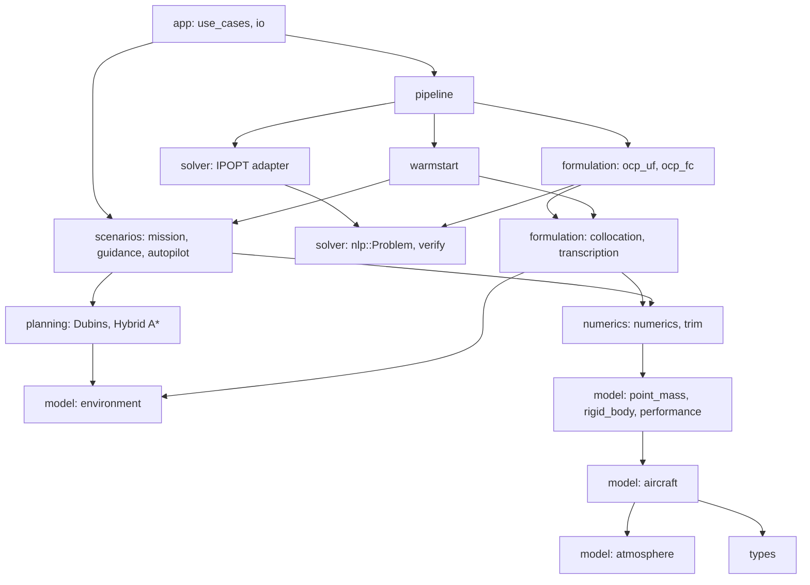
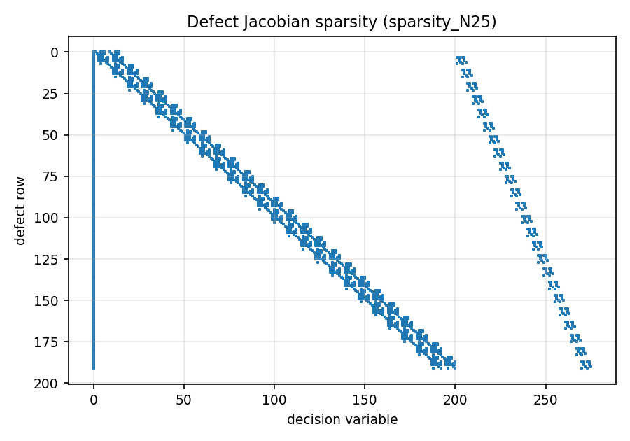

# Architecture

## Modules and dependencies

Each module has one header in `code/include/ofc/` and one source in `code/src/`. Dependencies only point downwards:



| Header | Responsibility |
|---|---|
| `types.hpp` | `Vec`, `Vec3`, `Mat3`, cross product, rotations, unit conversion |
| `atmosphere.hpp` | ISA troposphere: T, p, ρ, σ and dρ/dh (needed by the analytic Jacobian) |
| `aircraft.hpp` | Grouped design data, JSON loading, validation, derived performance |
| `performance.hpp` | Power required/available, climb rate, max level speed, ceilings, level turns |
| `point_mass.hpp` | UF model: `rhs`, analytic `jacobian`, load factor, fuel flow |
| `rigid_body.hpp` | FC model: rotations, air data (α, β, Vₐ), coefficient build-up, `rhs` |
| `numerics.hpp` | Finite-difference Jacobian (forward or central), dense solve, Newton, RK4 |
| `trim.hpp` | UF trim (closed form) and FC trim (Newton on u̇, ẇ, q̇) |
| `environment.hpp` | No-fly zones (polygon, altitude band, margin, signed distance) and waypoints |
| `planner.hpp` | Dubins paths (six words), Hybrid A\* search, mission legs through waypoints |
| `scenario.hpp` | Guidance (heading step or L1 path following), UF dynamic inversion, FC autopilot |
| `mission.hpp` | `MissionSpec`: poses, climb, speed, zones and waypoints, from JSON |
| `collocation.hpp` | Decision-vector layout, pack/unpack/resample, trapezoidal defects and their Jacobian |
| `transcription.hpp` | `TrapezoidalUF`: UF defects, analytic Jacobian, path rows, cost and gradient, simple guesses |
| `nlp.hpp` | `nlp::Problem` interface, `nlp::verify`, `nlp::jacobianError` |
| `ocp_problem.hpp` | `CollocationProblem`: bounds, boundary, path and waypoint rows, full sparse Jacobian, labels |
| `ocp_uf.hpp`, `ocp_fc.hpp` | `UfProblem`, `FcProblem`: each model completed into an `nlp::Problem` |
| `solver.hpp` | `nlp::solve` (IPOPT adapter), options, status |
| `warm_start.hpp` | `ws::build` (planner + guidance), resampling, cold starts, UF → FC projection |
| `pipeline.hpp` | `pipeline::run`: warm start → UF → FC → verification; checks along the optimal path |
| `use_cases.hpp`, `io.hpp` | Command-line use cases, JSON case files, CSV and JSON output |

The compiled library `ofc_core` holds everything except `main.cpp`. Both the `ofc` executable and `ofc_tests` link against it. IPOPT, when found, is linked to `ofc_core`; only `ipopt_solver.cpp` includes its headers.

## Conventions

- **Frames.** Positions are NED (z positive down, so altitude h = −z). Body axes are x forward, y right, z down. Euler angles are 3-2-1 (ψ, θ, φ).
- **Units.** SI throughout the code. Angles are radians internally; in input files they are degrees, and those keys always end in `_deg`.
- **Inequalities.** `h(z) ≤ 0` means satisfied. Every constraint is normalised by its limit, so the values are comparable across constraints and the verification tolerance is relative.
- **Scaling.** Defect rows are divided by a reference scale per state, the same normalisation described in [8. Transcription](../08-transcription.md). The solver also sees every variable divided by its scale. In the optimisation problems both sets of scales come from the mission's reference length and time, so they do not depend on the initial guess.

## Decision-vector layout

```
index:  0 | 1 ............................ N·nx | N·nx+1 ................ N·(nx+nu)
        tf| x_0 (nx) | x_1 | ... | x_{N-1}       | u_0 (nu) | ... | u_{N-1}
```

UF has nx = 8, nu = 3 (1 + 11N variables); FC has nx = 13, nu = 4 (1 + 17N variables). Defect row block k couples only nodes k and k+1 (plus t_f), so that part of the Jacobian is block-banded. At N = 200 only 0.44 % of the UF defect Jacobian's entries are nonzero.

{ width="55%" }

## The optimisation layer

`nlp::Problem` is the contract between the formulation and the solver:

| IPOPT callback | `nlp::Problem` method | Provided by |
|---|---|---|
| `get_nlp_info`, `get_bounds_info` | `numVariables`, `numConstraints`, `variableBounds`, `constraintBounds` | `CollocationProblem` |
| `get_starting_point` | `initialPoint` (the warm start) | `CollocationProblem` |
| `eval_f`, `eval_grad_f` | `cost`, `costGradient` | `UfProblem` (from `TrapezoidalUF`), `FcProblem` |
| `eval_g` | `constraints` = [defects, boundary, path, waypoints] | `CollocationProblem` + model |
| `eval_jac_g` | `constraintJacobian` (triplets, fixed structure) | `CollocationProblem` + model |
| `eval_h` | not provided: limited-memory BFGS | IPOPT |

The adapter (`src/solver/ipopt_solver.cpp`) handles four things:

- **Scaling.** It hands IPOPT `y = z / s` with `s = variableScale()`, and maps every callback back to z.
- **Sparsity.** It records the Jacobian structure once, from the initial point.
- **Robustness.** It rejects non-finite evaluations, so IPOPT backtracks instead of failing.
- **Results.** It maps IPOPT's return codes to `solved`, `acceptable`, `infeasible`, `max_iter`, `max_time` or `failed`.

Without IPOPT the same file compiles a stub that returns `no_solver`, so the rest of the library and the tests build everywhere.

`nlp::verify` re-evaluates a point against every row and bound and groups the violations by kind: dynamics, boundary, envelope, environment, bounds. For each group it gives the count, the worst value and the worst row's label (for example `nfz:A @41`). The pipeline marks a stage `ok` only if IPOPT converged and the verification passed.

[← Overview](index.md) · [Next: Formulation in code →](formulation.md)
