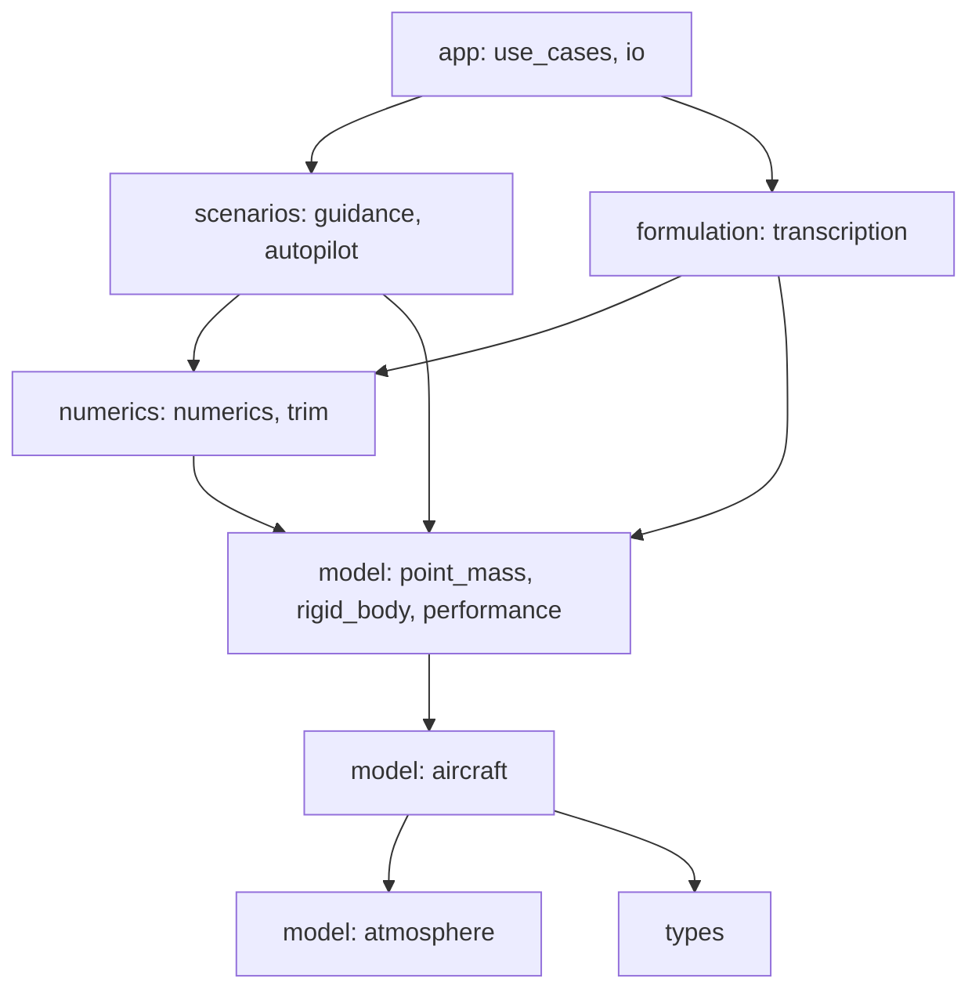

# Architecture

## Modules and dependencies

Each module has one header in `code/include/ofc/` and one source in `code/src/`. Dependencies only point downwards:



| Header | Responsibility |
|---|---|
| `types.hpp` | `Vec`, `Vec3`, `Mat3`, cross product, rotations, unit conversion |
| `atmosphere.hpp` | ISA troposphere: T, p, ρ, σ and dρ/dh (needed by the analytic Jacobian) |
| `aircraft.hpp` | Grouped design data, JSON loading, validation, derived performance |
| `performance.hpp` | Power required/available, climb rate, max level speed, ceilings, level turns |
| `point_mass.hpp` | UF model: `rhs`, analytic `jacobian`, load factor, fuel flow |
| `rigid_body.hpp` | FC model: rotations, air data (α, β, Vₐ), coefficient build-up, `rhs` |
| `numerics.hpp` | Finite-difference Jacobian (forward or central), dense solve, Newton, RK4 |
| `trim.hpp` | UF trim (closed form) and FC trim (Newton on u̇, ẇ, q̇) |
| `transcription.hpp` | `TrapezoidalUF`: decision vector, defects, sparse Jacobian, constraints, cost, guesses |
| `scenario.hpp` | Design scenarios: shared guidance, UF dynamic inversion, FC autopilot |
| `use_cases.hpp`, `io.hpp` | Command-line use cases, JSON case files, CSV output |

The compiled library `ofc_core` holds everything except `main.cpp`. Both the `ofc` executable and `ofc_tests` link against it.

## Conventions

- **Frames.** Positions are NED (z positive down, so altitude h = −z). Body axes are x forward, y right, z down. Euler angles are 3-2-1 (ψ, θ, φ).
- **Units.** SI throughout the code. Angles are radians internally; in input files they are degrees, and those keys always end in `_deg`.
- **Inequalities.** `h(z) ≤ 0` means satisfied. Every constraint is normalised by its limit, so the values are comparable across constraints.
- **Scaling.** Defect rows are divided by a reference scale per state (`UfScales`): the mission distance for positions, V_cruise for speed, the active limits for angles, and m₀ for mass. This keeps every residual of order one, the same normalisation described in [8. Transcription](../08-transcription.md).

## Decision-vector layout (`TrapezoidalUF`)

```
index:  0 | 1 ............................ N·NX | N·NX+1 ................ N·(NX+NU)
        tf| x_0 (NX) | x_1 | ... | x_{N-1}       | u_0 (NU) | ... | u_{N-1}
```

With NX = 8 and NU = 3 there are 1 + 11N variables and 8(N−1) defects. Defect row block k couples only nodes k and k+1 (plus t_f), so the Jacobian is block-banded. At N = 200 only 0.44 % of the entries are nonzero.

{ width="55%" }

## Plugging in an optimiser

`TrapezoidalUF` is solver-agnostic. An interior-point solver needs exactly what it exposes:

| Solver callback | Function |
|---|---|
| objective f(z) | `cost(z)` |
| gradient ∇f(z) | `costGradient(z)` |
| equality constraints | `defects(z)` and `boundaryResiduals(z)` |
| inequality constraints | `pathConstraints(z)` (with upper bound 0) |
| constraint Jacobian | `defectJacobian(z)` (triplets); the boundary and path rows can start with `num::fdJacobian` |
| initial point | `coldStartGuess`, `trimmedLineGuess`, or a trajectory flown by `scenario::fly` |

The public edition intentionally stops here (see [Scope](index.md#scope)).

[← Overview](index.md) · [Next: Formulation in code →](formulation.md)
