# Worked examples and design scenarios

!!! abstract "TL;DR"
    All seven use cases run on the generic UAV. Headline result first, then the deeper ones:

    - **Missions with no-fly zones and waypoints (UC-07).** Hybrid A\* finds a flyable path in 0.01–2 s (machine-dependent). UF and FC fly it while staying 11–16 m outside every margin and passing within 1.1 m of each waypoint. The straight-line cold start runs 200–394 m deep into the zones.
    - The design charts give a classic envelope: V_stall 15.1 m/s, best L/D at 20.8 m/s, V_max 36.9 m/s and a service ceiling of 5.9 km.
    - The four typical scenarios (straight and level, climb, 180° turn, climb plus turn) are flown by both models. UF and FC agree to within 0.2–67 m, with the same fuel to 0.1 g.
    - The climbs are power-limited, and the least-fuel speed (22 m/s) sits next to the best-L/D speed.
    - The analytic Jacobian is 57–487× faster than forward differences, and the gap grows with N.

All numbers on this page come from `bash run.sh` in `code/`, using the case files in `code/data/cases/`. The figures are produced by `utils/plot_results.py`. Timings depend on the machine; the trends do not.

!!! note "What these results are and are not"
    These are **flyable reference trajectories** produced by a guidance law, together with design charts. They are **not optimal trajectories**: the optimiser is not part of the public edition. The optimal solutions of the thesis (with the real aircraft) are in [12. Validation](../12-results-validation.md) and [14. Warm-start benchmark](../14-results-warmstart.md).

## The generic aircraft

An 11 kg, 2.9 m-span UAV. Its mass, geometry, inertia, lift, side-force and moment derivatives follow the Aerosonde-class model of Beard & McLain (2012). Its drag polar ($C_{D0}=0.030$, $k=0.055$), propulsion (800 W, $\eta_p=0.7$, SFC 0.6 kg/kWh) and envelope limits are illustrative values chosen for this example. Data file: `code/data/aircraft/generic_uav.json` ([format](aircraft-format.md)).

## UC-07 — Missions with no-fly zones and waypoints

!!! tip "The headline result"
    These missions are the cover of the repository. The rest of this page goes deeper: from the aircraft report (UC-01) to the typical design scenarios (UC-06).

These are the same families as the thesis benchmark ([14. Warm-start benchmark](../14-results-warmstart.md)), scaled to the generic UAV: 25 m/s, 30° bank, and a planning radius of 143 m.

| Mission | Content |
|---|---|
| M-01 | One NFZ on the direct route |
| M-02 | Slalom between two NFZs |
| M-03 | Two waypoints, no NFZ |
| M-04 | One NFZ, one waypoint, a 150 m climb and a final heading change; a low NFZ (top 200 m) on the direct route is overflown |

```text
id      mission                        | planMs   R[m]   path |   t_UF   t_FC |  clrUF  clrFC |   wpUF   wpFC |     |D|N    |D|4N |  nfzRun nfzCold
M-01    One NFZ on the direct route    |    943    143   3204 |  128.0  128.0 |     11     11 |    0.0    0.0 |  1.5e-01  3.7e-03 |   -0.29   10.85
M-02    Slalom between two NFZs        |   1782    143   3753 |  150.0  149.9 |     12     12 |    0.0    0.0 |  3.7e-01  9.7e-03 |   -0.30    6.01
M-03    Waypoints only                 |     15    143   4311 |  172.4  172.2 |    n/a    n/a |    1.1    1.0 |  5.5e-01  1.4e-02 |     n/a     n/a
M-04    NFZ, waypoint, climb; low NFZ  |   1370    143   3921 |  159.3  157.8 |     16     16 |    0.8    0.7 |  1.4e-01  4.4e-03 |   -0.40    8.90
```

<figure markdown>
  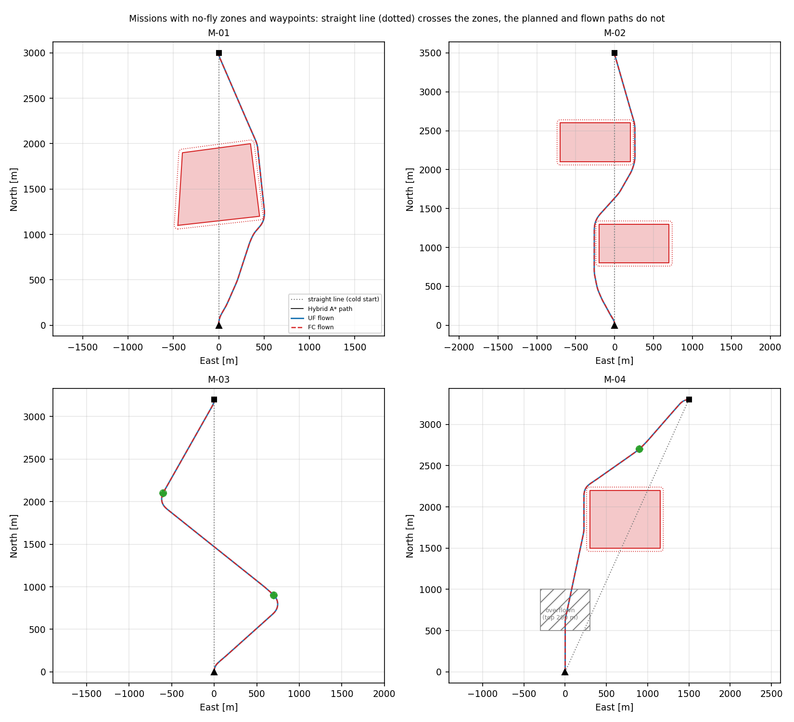{ width="100%" }
  <figcaption>Top views of the four missions. Red: active no-fly zones, with their margin dotted. Hatched grey: a zone below the flight altitude, overflown. Dotted grey: the straight-line cold start. Black: the Hybrid A* path. Blue and red dashed: the point-mass and 6-DoF trajectories. Green diamonds: waypoints, with their tolerance circle.</figcaption>
</figure>

=== "M-01 one NFZ"
    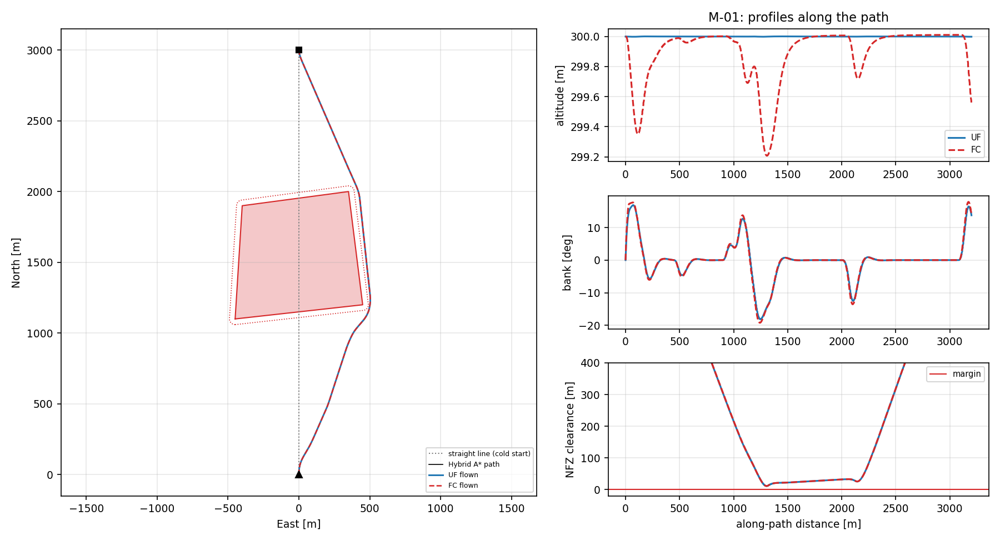
    The planner goes round the east side of the zone. Both models keep 11 m outside the 40 m margin (the planner's own safety distance is 10 m) and arrive on the final heading.

=== "M-02 slalom"
    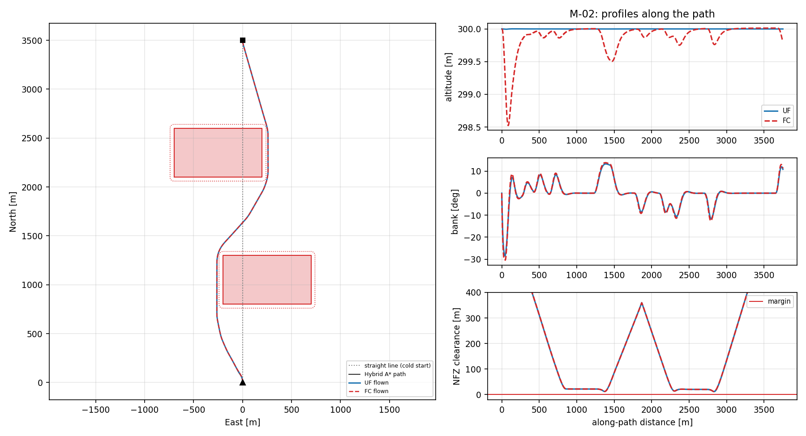
    Two zones block opposite sides of the direct route, so the path weaves between them. The clearance plot touches the margin twice, once per zone, and never crosses it.

=== "M-03 waypoints"
    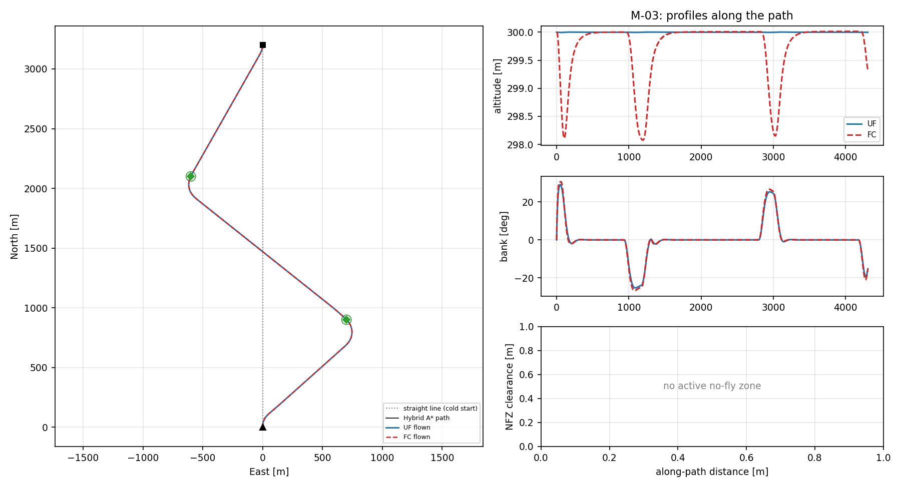
    Each waypoint is reached heading towards the next target. Both models pass within 1.1 m of each waypoint against a 40 m tolerance.

=== "M-04 NFZ + waypoint + climb"
    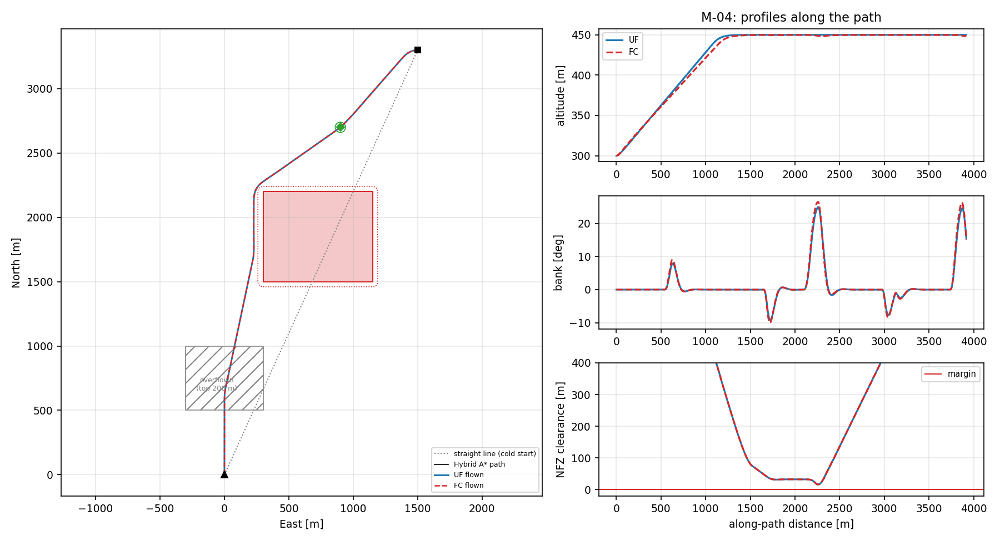
    The low zone (top at 200 m) is overflown, because the flight starts at 300 m and climbs to 450 m. The planner ignores it and the direct route crosses it legitimately. The high zone A is avoided, and the waypoint and the final easterly heading are met.

How to read the results:

- **The cold start would be infeasible.** The straight line between the same end points gives NFZ rows of +6 to +11 in the NLP. With a 40 m margin that means 200–394 m inside the zones, or 240–434 m past the margin. The planned and flown trajectories give −0.3 to −0.4, so they are outside every margin. This is the same reason the thesis's cold start failed in its NFZ and waypoint scenarios.
- **The planner is cheap, and the guidance holds the path.** Planning takes 0.01–2 s, depending on the machine. UF and FC end with the same clearance to the metre, and it stays above the planner's safety distance, so the 0.8 bank fraction leaves enough room to track the path.
- **Mesh resolution.** The flown trajectories satisfy the collocation equations to 0.14–0.55 on 80 nodes, and to 0.004–0.014 on 320 nodes. As in UC-06, the mesh must resolve the turns.
- **What is still missing for an optimum.** A trajectory like this is the warm start that the thesis then hands to the UF and FC optimisation stages. That stage, the optimiser, is not part of the public edition.

## UC-01 — Aircraft report

```text
aero     : CL_max 1.405, k 0.0550, (L/D)max 12.31 at CL 0.739

   h [m]        rho    V_stall    V_(L/D)  P_max [W] T_max@Vc [N]
       0     1.2250      15.10      20.82        800         22.4
    1000     1.1116      15.85      21.86        716         20.1
    2000     1.0065      16.66      22.97        638         17.9
    4000     0.8191      18.46      25.46        500         14.0

min turn radius at V_cruise, phi_max: 76.0 m
```

## UC-02 — Trim

```text
condition: V 25.00 m/s, h 300 m, gamma 0.00 deg, mu 0.00 deg
[UF] T 9.27 N, CL 0.5274, n 1.000 g, within limits: yes
[FC] alpha 3.198 deg, theta 3.198 deg, delta_e -8.071 deg, T 9.25 N
     Newton: 2 iterations, residual 9.50e-16, converged: yes
```

The two models need the same thrust (9.27 N against 9.25 N), because they share the lift and drag description. The small difference is the thrust component along the flight path, $T\cos\alpha$, in the 6-DoF trim.

## UC-03 — Open-loop simulation

```text
[UF] bank 30.0 deg after 60 s, heading change 764.6 deg, altitude change 0.01 m
     expected steady turn radius 110.4 m
[FC] doublet 2.0 deg: altitude band [299.7, 300.2] m, final theta 3.15 deg
```

<figure markdown>
  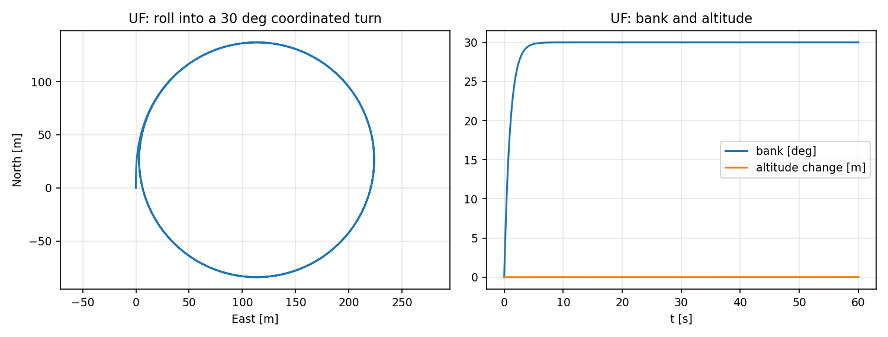{ width="80%" }
  <figcaption>UF rolling into a 30° coordinated turn. The heading rate matches g·tanφ/V and the altitude stays constant.</figcaption>
</figure>

<figure markdown>
  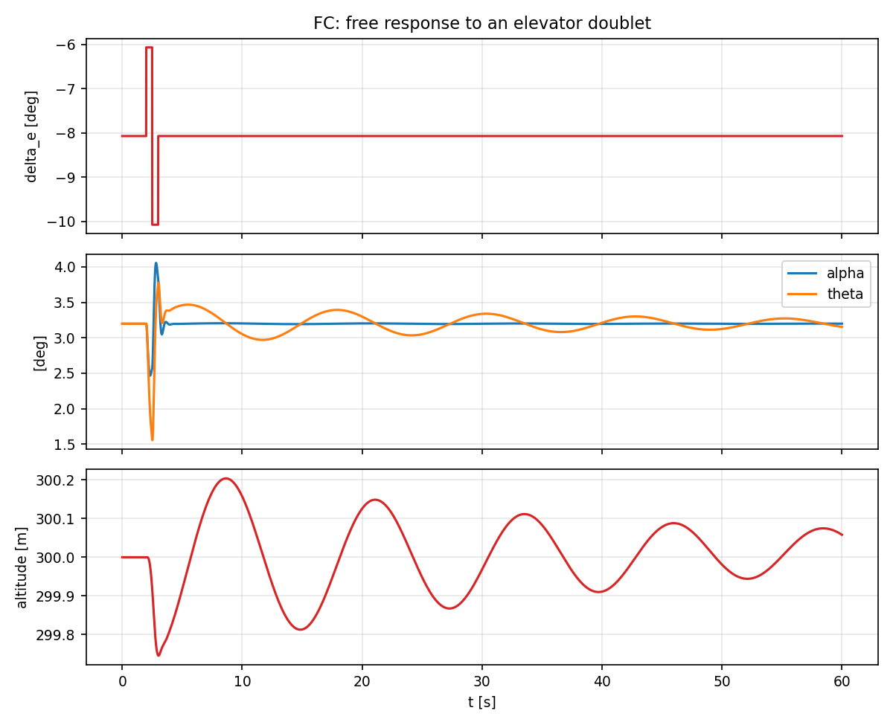{ width="70%" }
  <figcaption>FC after an elevator doublet. The short-period mode is the fast α oscillation that dies out in about 1 s. The phugoid is the slow exchange between speed and altitude, with a period of about 12 s (theory: 2πV/(g√2) ≈ 11 s).</figcaption>
</figure>

## UC-04 — The NLP an optimiser would see

Straight 3.1 km leg with a 100 m climb, point-mass model, trapezoidal collocation:

```text
    N    vars defects      nnz    dens% |    |D|cold    |D|trim |  J_an[ms]  J_fd[ms]  speedup |   jac err
   25     276     192     1872     3.53 |   7.76e+00   1.65e-15 |     0.098      5.54      57x |   6.5e-11
   50     551     392     3822     1.77 |   3.80e+00   1.08e-15 |     0.180     20.69     115x |   8.1e-11
  100    1101     792     7722     0.89 |   1.88e+00   3.99e-16 |     0.377    112.74     299x |   8.8e-11
  200    2201    1592    15522     0.44 |   9.36e-01   2.65e-16 |     0.654    318.58     487x |   7.7e-11
```

<figure markdown>
  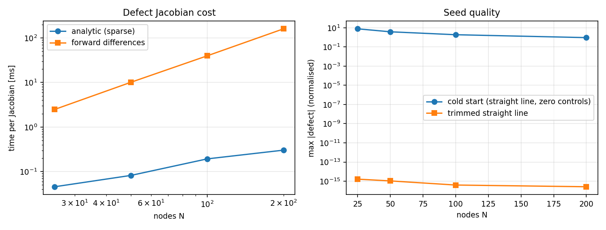{ width="90%" }
  <figcaption>Left: cost of one defect Jacobian. Right: seed quality of a cold start against a trimmed straight line.</figcaption>
</figure>

- **Derivatives.** Forward differences need one full evaluation of the defects per decision variable, so their cost grows as O(N²). The sparse analytic Jacobian grows as O(N). Both agree to about 1e-10. This is the mechanism behind the speed-up between the two versions of the thesis solver: the published results were computed with finite differences, and a later version uses exact derivatives.
- **Seed quality.** A cold start (straight line, zero controls) violates the dynamics by O(1). A trimmed line satisfies them to machine precision. That gap is why an interior-point solver started cold spends so many iterations in restoration (see [11. Warm start](../11-warm-start.md)).
- **Sparsity.** At N = 200 only 0.44 % of the Jacobian entries are nonzero ([spy plot](architecture.md#decision-vector-layout-trapezoidaluf)).

## UC-05 — Design charts

```text
mass 11.00 kg, service ceiling (0.5 m/s) 5907 m, absolute ceiling 7005 m

  h [m]   V_stall    V_minP   V_(L/D)     V_max   ROC_max   @V [m/s]
      0     15.10     15.84     20.82     36.89      3.71      15.84
   2000     16.66     17.47     22.97     35.80      2.51      17.47
   4000     18.46     19.32     25.46     34.02      1.43      19.32
   6000     20.57     21.54     28.37     30.24      0.46      21.54
```

<figure markdown>
  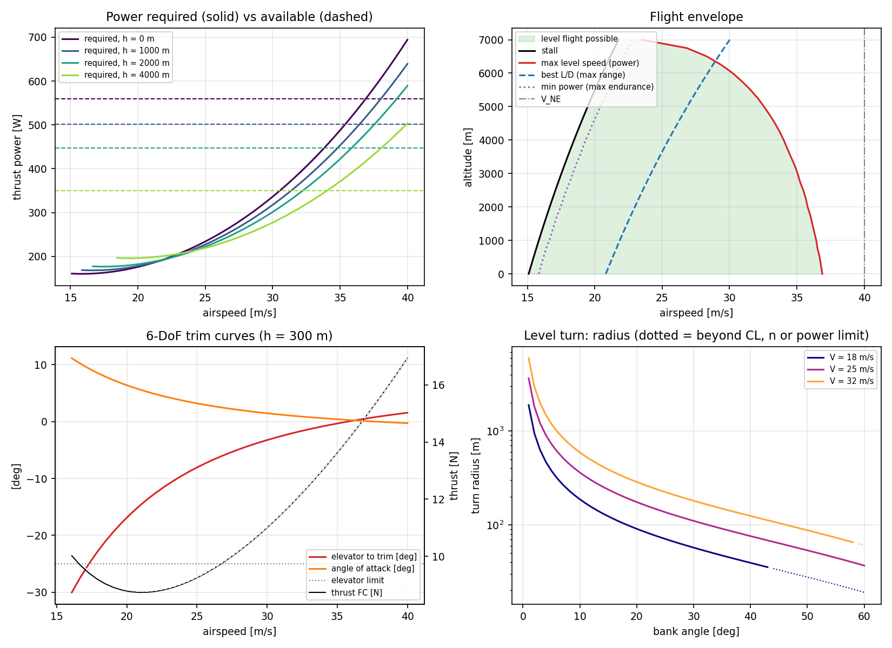{ width="100%" }
  <figcaption>Design charts of the generic UAV.</figcaption>
</figure>

How to read the four panels:

1. **Power curves.** Required power has its minimum at the best-endurance speed. It crosses the available power (dashed, falling with altitude) at the maximum level speed.
2. **Flight envelope.** Level flight is possible between the stall line and the power-limited maximum speed. The band closes at the absolute ceiling (≈ 7.0 km). V_NE never limits this aircraft because power runs out first. The best-endurance and best-range speeds (min power, best L/D) rise with altitude as 1/√σ.
3. **6-DoF trim curves.** The elevator needed to trim reaches the ±25° limit below about 17 m/s. **Elevator authority, not stall, sets the minimum trimmed speed** (V_stall = 15.3 m/s at 300 m). A slope of δ_e against V that is negative at low speed and flattens out is the signature of a statically stable aircraft. The 6-DoF and point-mass trim thrusts coincide (black and white dashed lines).
4. **Level turns.** Turn radius against bank. Dotted segments break a limit: C_L,max at 18 m/s beyond about 43° of bank, and power at 32 m/s beyond about 58°.

## UC-06 — Typical design scenarios

The same 2 × 2 design as the thesis's [validation scenarios](../12-results-validation.md): straight or 180° turn, level or +200 m climb. Each is flown at 25 m/s, with 30° of bank in turns and a 7.5° climb angle, by the point-mass model (UF, dynamic inversion) and the 6-DoF model (FC, autopilot).

```text
id     scenario                 |   t_UF   t_FC dev[m] |  fuelUF  fuelFC | dh_end   bank |     |D|N    |D|4N | tightest       h | V*fuel
SC-00  Straight, level          |  120.0  120.0    0.2 |  0.0066  0.0066 |   0.01    0.0 |  4.7e-08  1.5e-08 | v_ne      -0.375 |     22
SC-01  Straight, climb +200 m   |  123.9  121.8   12.1 |  0.0116  0.0117 |  -0.31    0.0 |  1.5e-01  4.2e-03 | power      0.000 |     22
SC-02  180 deg turn, level      |  100.0   99.8   15.5 |  0.0056  0.0056 |   0.01   30.8 |  5.9e-01  6.9e-02 | v_ne      -0.375 |     22
SC-03  Climb +200 m and 180 deg |  104.4  101.3   66.8 |  0.0106  0.0107 |  -0.31   31.4 |  1.1e+00  1.6e-01 | power      0.000 |     22
```

<figure markdown>
  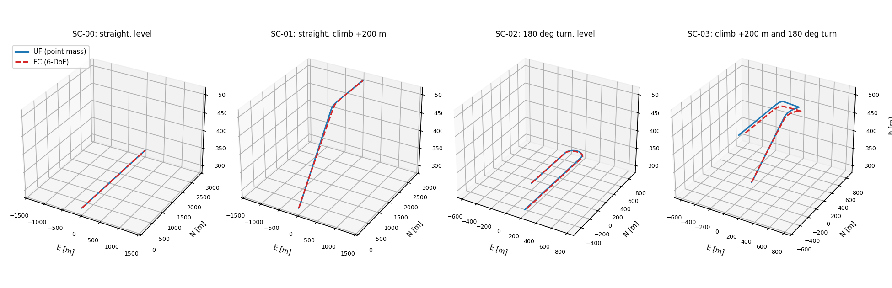{ width="100%" }
  <figcaption>The four design scenarios flown by the point-mass model (solid) and the 6-DoF model (dashed).</figcaption>
</figure>

=== "SC-00 straight, level"
    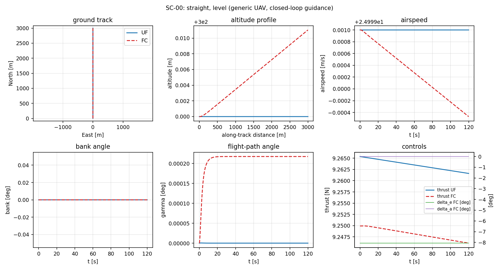
    The baseline. Both models stay at the trim point, and UF and FC are 0.2 m apart after 3 km.

=== "SC-01 climb +200 m"
    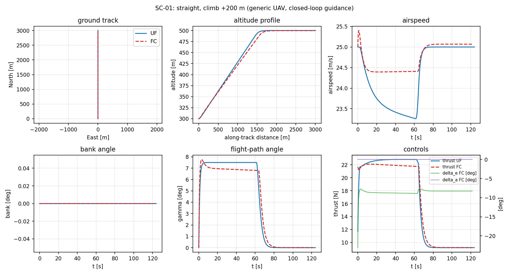
    Climbing at 7.5° needs more power than is available, so **the power constraint is active** (h = 0.000). The two models resolve the shortfall differently. UF holds the climb angle and bleeds airspeed. FC holds attitude and gives up a little climb angle. The fuel is the same (11.6 against 11.7 g).

=== "SC-02 180° turn, level"
    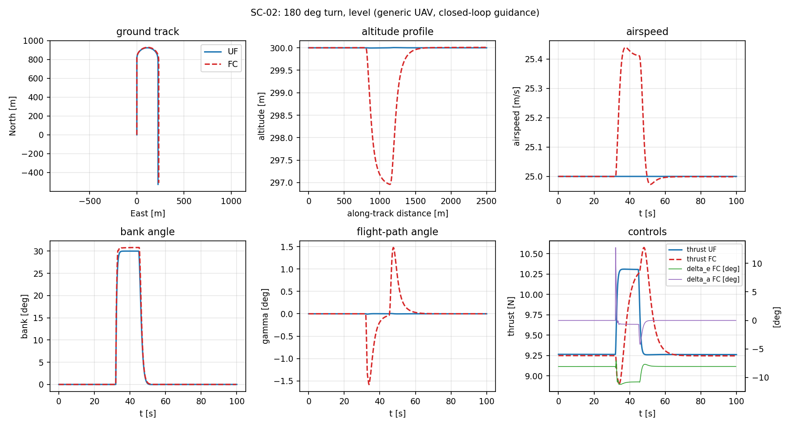
    FC loses about 3 m entering the turn while the autopilot builds up the extra lift (n = 1.15 g), then recovers. UF has no attitude dynamics, so it holds altitude exactly. The ground tracks differ by at most 15.5 m.

=== "SC-03 climb + 180° turn"
    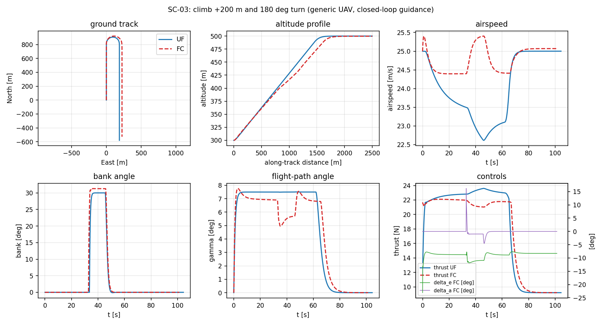
    The hardest case: a power-limited climb that runs through a turn. UF slows to 22.6 m/s and turns tighter. FC keeps more speed and turns wider. This is the largest UF–FC difference (66.8 m), the same kind of model gap discussed in the thesis's UF–FC consistency check.

### Speed trade-off: minimum time against minimum fuel

Each scenario is flown again by the point-mass model at commanded speeds from 18 to 36 m/s:

<figure markdown>
  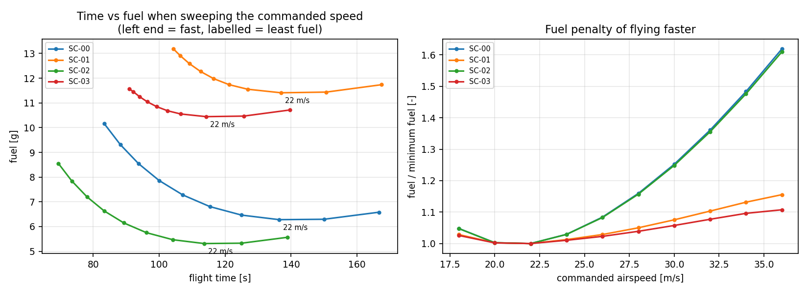{ width="95%" }
  <figcaption>Left: fuel against flight time for each scenario as the speed changes (fast on the left; labelled points use the least fuel). Right: fuel relative to the minimum.</figcaption>
</figure>

- **The least-fuel speed is 22 m/s in every scenario**, next to the best-L/D speed (21 m/s at 300 m). Fuel per metre is proportional to drag, which is lowest at best L/D. This is the minimum-fuel signature of the thesis ($\alpha = 1$).
- **Flying fast costs fuel.** At 36 m/s the level scenarios burn about 60 % more fuel to save about 40 % of the time. This is the curve the cost weight $\alpha$ of the [Bolza cost](../10-cost-function.md) moves along.
- **Climbs flatten the curve.** Part of the fuel goes into potential energy whatever the speed, and at high speed the climb becomes power-limited, so time stops improving.

### The scenarios inside the NLP

Each UF trajectory is resampled on N = 60 and 4N = 240 uniform nodes and passed to `TrapezoidalUF` as a candidate solution:

- **Straight and level.** The defect is at round-off level (≈ 1e-8), so the trajectory is dynamically consistent.
- **Manoeuvres.** On 60 nodes (about 1.7 s spacing), the roll-in and pull-up transients, which last about 1 s, are not resolved, and the defect reaches O(0.1–1). Refining to 240 nodes cuts it by 7–36×. **The mesh must resolve the fastest manoeuvre in the mission.** The production solver chooses N automatically from the path length, which is why.
- **Constraints.** Every path constraint is satisfied (h ≤ 0). The closest to its limit are the power constraint during climbs, which is active, and V_NE in level flight.

A trajectory like this is exactly what a warm start hands to the optimiser: flyable, nearly consistent with the collocation equations, and inside the envelope.

[← Use cases](use-cases.md) · [Aircraft file format →](aircraft-format.md)
