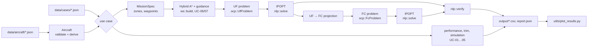

# Code: public implementation

!!! abstract "TL;DR"
    `code/` is a self-contained C++17 implementation of the thesis method, end to end. It covers a generic aircraft described in JSON, the point-mass (UF) and 6-DoF (FC) models, the trapezoidal collocation of both optimal-control problems with their constraints and cost, and the warm-start chain (Hybrid A\* path → guidance laws → UF → FC projection). It solves both problems with **IPOPT** and verifies every optimum independently. Nine runnable use cases cover the aircraft's design charts, four typical design scenarios, four constrained missions planned and flown, the same missions optimised, and a warm-start benchmark. IPOPT is optional at build time; without it, everything except the two optimisation use cases still runs.

!!! warning "A clean-room implementation"
    The production solver was developed as a product for Singular Aircraft and stays private; nothing from it is in this repository. This implementation was written from the thesis equations, with its own structure, naming and settings, and a **generic aircraft** whose coefficients come from public sources.

## Quick start

Requirements: CMake ≥ 3.14 and a C++17 compiler (GCC, Clang or MSVC). For the optimiser, IPOPT and `pkg-config` (`sudo apt install coinor-libipopt-dev pkg-config` on Linux / WSL, `brew install ipopt pkg-config` on macOS). Python with `numpy` and `matplotlib` is only needed for the figures.

```bash
cd code
bash run.sh          # Linux / macOS / Git Bash: build, tests, 9 use cases, figures
.\utils\install_ipopt.ps1   # Windows PowerShell, once: official IPOPT binaries (needs Visual Studio 2022+)
.\run.ps1                   # Windows PowerShell (without IPOPT: UC-08/09 are skipped)
./build/ofc --info   # is the optimiser in this build?
```

Run a single case by hand, from `code/`:

```bash
cmake -S . -B build -DCMAKE_BUILD_TYPE=Release && cmake --build build
./build/ofc data/cases/uc08_optimal_missions.json
python utils/plot_results.py            # figures in output/figures/
```

## What it contains

| Use case | What it does | Page |
|---|---|---|
| UC-01 Aircraft report | Derived performance from the design data | [Examples](examples.md#uc-01-aircraft-report) |
| UC-02 Trim | Steady flight: UF closed form, FC Newton on the force/moment balance | [Examples](examples.md#uc-02-trim) |
| UC-03 Simulation | RK4: UF coordinated turn, FC elevator doublet | [Examples](examples.md#uc-03-open-loop-simulation) |
| UC-04 Transcription check | NLP size, sparsity, seed quality, analytic vs finite-difference Jacobian | [Examples](examples.md#uc-04-the-nlp-an-optimiser-sees) |
| UC-05 Design charts | Power curves, flight envelope, trim curves, turn performance | [Examples](examples.md#uc-05-design-charts) |
| UC-06 Design scenarios | SC-00…SC-03 flown by UF and FC, speed trade-off, NLP evaluation | [Examples](examples.md#uc-06-typical-design-scenarios) |
| UC-07 Missions with NFZs and waypoints | Hybrid A\* path around no-fly zones and through waypoints, flown by UF and FC with L1 guidance | [Examples](examples.md#uc-07-missions-with-no-fly-zones-and-waypoints) |
| **UC-08 Optimal missions** | Warm start → UF optimum → FC optimum with IPOPT, verified and exported | [Examples](examples.md#uc-08-optimal-missions) |
| **UC-09 Warm-start benchmark** | Cold vs warm start, FC seeded directly vs through UF, on identical problems | [Examples](examples.md#uc-09-warm-start-benchmark) |

## How it works



1. **Aircraft.** The JSON is validated, with errors that name the field: mass budget, positive-definite inertia, static pitch stability, stall speed below V_NE. Everything derived (V_stall(h, m), CL_max, T_max, best L/D) is computed from it and never typed in. See the [aircraft file format](aircraft-format.md).
2. **Models.** `uf::rhs`, `uf::jacobian` and `fc::rhs` are pure functions f(x, u, wind).
3. **Warm start.** Hybrid A\* plans a turn-radius-feasible path around the active zones and through the waypoints. Guidance laws fly it, the point mass by dynamic inversion and the rigid body with an autopilot. The flown runs nearly satisfy the collocation equations.
4. **Optimal-control problems.** `ocp::CollocationProblem` assembles the constraint vector (defects, boundary, path, waypoints), its sparse Jacobian, bounds, scales and labels. `UfProblem` and `FcProblem` supply each model's defects, path rows and cost. See [Formulation in code](formulation.md).
5. **Solver.** `nlp::solve` adapts any `nlp::Problem` to IPOPT. It scales the variables and uses the exact gradient, the sparse Jacobian and a limited-memory Hessian.
6. **Pipeline.** `pipeline::run` sequences warm start → UF → FC, records status, iterations and time per stage, and runs `nlp::verify` on each optimum.

## Scope

| Included | Production only (not published) |
|---|---|
| Generic aircraft model, data validation, point performance | Real aircraft data |
| UF and FC dynamics, ISA atmosphere, constant wind | Layered wind profiles, geodetic (WGS-84) mission frames |
| Trapezoidal transcription of both models; sparse constraint Jacobian; time–fuel cost with control and attitude smoothing | Production cost weights, tuned solver settings, exact derivatives by automatic differentiation of the FC model |
| IPOPT interface, two-stage UF → FC optimisation, independent verification | Status/severity reporting, inverse-mass targeting and fuel-reserve checks |
| Envelope and boundary constraints; coordinated flight; polygonal no-fly zones with altitude band and margin; waypoints with tolerance | Terrain (DEM), geofences, polyhedral NFZ with strictness, waypoint attitude/speed conditions |
| Hybrid A\* planner (Dubins heuristic, analytic expansion), guidance laws (L1, dynamic inversion, autopilot), UF → FC projection | Inverse-dynamics warm start of the production chain |
| Trim, RK4 simulation, closed-loop scenarios, benchmark, 34 tests | Mission dispatcher, autopilot export, web viewer |

The excluded parts are described (equations, pseudocode and results) in the Theory and Results chapters of this documentation.

## Layout

```
code/
├── data/aircraft/     generic_uav.json
├── data/cases/        uc01 … uc09 case files
├── include/ofc/       one header per module
├── src/model/         atmosphere, aircraft, performance, environment (NFZ, waypoints), UF, FC
├── src/numerics/      finite differences, Newton, RK4, trim
├── src/planning/      Dubins paths, Hybrid A*, mission legs through waypoints
├── src/scenarios/     mission description, guidance (heading step or L1), UF dynamic inversion, FC autopilot
├── src/warmstart/     planner + guidance → initial points, UF → FC projection, cold starts
├── src/formulation/   collocation, TrapezoidalUF, UF and FC optimal-control problems
├── src/solver/        nlp::Problem, verification, IPOPT adapter
├── src/pipeline/      staged optimisation of one mission
├── src/app/           use cases, JSON/CSV I/O;  src/main.cpp = CLI
├── tests/             dependency-free unit tests (ctest)
├── third_party/       nlohmann/json 3.12.0 (MIT)
└── utils/             plot_results.py
```

[Next: Architecture →](architecture.md)
