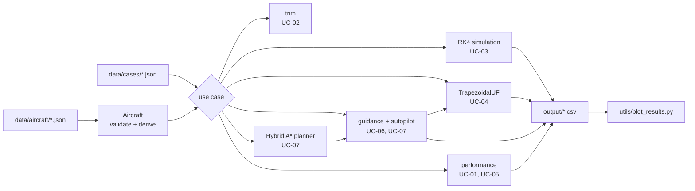

# Code: public edition

!!! abstract "TL;DR"
    `code/` is a self-contained C++17 implementation of the thesis's **formulation block**: a generic aircraft described in JSON, the point-mass (UF) and 6-DoF (FC) models, the trapezoidal collocation of the optimal-control problem with an analytic sparse Jacobian, and its constraints and cost. It also includes a Hybrid A\* planner and L1 path following for missions with no-fly zones and waypoints. Seven runnable use cases cover the aircraft's design charts, four typical design scenarios and four constrained missions. The optimiser and the remaining production features (terrain, geofences, the optimisation stages of the warm-start chain) are **not** included.

!!! warning "A restricted, clean-room edition"
    The production solver was developed as a product for Singular Aircraft and stays private. This edition was rewritten from the thesis equations. It has its own structure and naming, and a **generic aircraft** whose coefficients come from public sources, and it deliberately stops before the optimiser.

## Quick start

Requirements: CMake ≥ 3.14 and a C++17 compiler (GCC, Clang or MSVC). There are no other dependencies. Python with `numpy` and `matplotlib` is only needed for the figures.

```bash
cd code
bash run.sh          # Linux / macOS / Git Bash: build, 25 tests, 7 use cases, figures
.\run.ps1            # Windows PowerShell
```

Run a single case by hand, from `code/`:

```bash
cmake -S . -B build -DCMAKE_BUILD_TYPE=Release && cmake --build build
./build/ofc data/cases/uc06_design_scenarios.json
python utils/plot_results.py            # figures in output/figures/
```

## What it contains

| Use case | What it does | Page |
|---|---|---|
| UC-01 Aircraft report | Derived performance from the design data | [Examples](examples.md#uc-01-aircraft-report) |
| UC-02 Trim | Steady flight: UF closed form, FC Newton on the force/moment balance | [Examples](examples.md#uc-02-trim) |
| UC-03 Simulation | RK4: UF coordinated turn, FC elevator doublet | [Examples](examples.md#uc-03-open-loop-simulation) |
| UC-04 Transcription check | NLP size, sparsity, seed quality, analytic vs finite-difference Jacobian | [Examples](examples.md#uc-04-the-nlp-an-optimiser-would-see) |
| UC-05 Design charts | Power curves, flight envelope, trim curves, turn performance | [Examples](examples.md#uc-05-design-charts) |
| UC-06 Design scenarios | SC-00…SC-03 flown by UF and FC, speed trade-off, NLP evaluation | [Examples](examples.md#uc-06-typical-design-scenarios) |
| UC-07 Missions with NFZs and waypoints | Hybrid A\* path around no-fly zones and through waypoints, flown by UF and FC with L1 guidance, NFZ rows in the NLP | [Examples](examples.md#uc-07-missions-with-no-fly-zones-and-waypoints) |

## How it works



1. **Aircraft.** The JSON is validated, with errors that name the field: mass budget, positive-definite inertia, static pitch stability, stall speed below V_NE. Everything derived (V_stall(h, m), CL_max, T_max, best L/D) is computed from it and never typed in. See the [aircraft file format](aircraft-format.md).
2. **Models.** `uf::rhs`, `uf::jacobian` and `fc::rhs` are pure functions f(x, u, wind).
3. **Formulation.** `TrapezoidalUF` lays out the decision vector and evaluates everything an interior-point solver needs at each iteration: defects and their Jacobian, boundary residuals, path constraints, cost and gradient. See [Formulation in code](formulation.md).
4. **Scenarios.** A common guidance law (altitude → flight-path angle, heading or path → bank) drives the UF model by dynamic inversion and the FC model through a small autopilot. The resulting flyable trajectories are then evaluated in the NLP.
5. **Missions (UC-07).** Hybrid A\* plans a turn-radius-feasible path around the active no-fly zones and through the waypoints. The guidance follows it with the L1 law, and the NLP checks the result against one NFZ row per node and zone.

## Scope

| Included | Production only (not published) |
|---|---|
| Generic aircraft model, data validation, point performance | Real aircraft data |
| UF and FC dynamics, ISA atmosphere, constant wind | Layered wind profiles, geodetic (WGS-84) mission frames |
| Trapezoidal transcription, analytic UF Jacobian, cost and gradient | NLP solver interface (IPOPT) and its tuning |
| Envelope and boundary constraints; polygonal no-fly zones with altitude band and margin; waypoints with tolerance | Terrain (DEM), geofences, polyhedral NFZ with strictness, waypoint attitude/speed conditions |
| Hybrid A\* planner (Dubins heuristic and analytic expansion), L1 path following; cold-start, trimmed-line and guidance-flown trajectories | Inverse dynamics → UF → FC optimisation stages of the warm-start chain |
| Trim, RK4 simulation, closed-loop scenarios, 25 tests | Mission dispatcher, autopilot export, web viewer |

The excluded parts are described (equations, pseudocode and results) in the Theory and Results chapters of this documentation.

## Layout

```
code/
├── data/aircraft/     generic_uav.json
├── data/cases/        uc01 … uc07 case files
├── include/ofc/       one header per module
├── src/model/         atmosphere, aircraft, performance, environment (NFZ, waypoints), UF, FC
├── src/planning/      Dubins paths, Hybrid A*, mission legs through waypoints
├── src/numerics/      finite differences, Newton, RK4, trim
├── src/formulation/   trapezoidal transcription, constraints, cost, guesses
├── src/scenarios/     guidance (heading step or L1 path following), UF dynamic inversion, FC autopilot
├── src/app/           use cases, JSON/CSV I/O;  src/main.cpp = CLI
├── tests/             dependency-free unit tests (ctest)
├── third_party/       nlohmann/json 3.12.0 (MIT)
└── utils/             plot_results.py
```

[Next: Architecture →](architecture.md)
