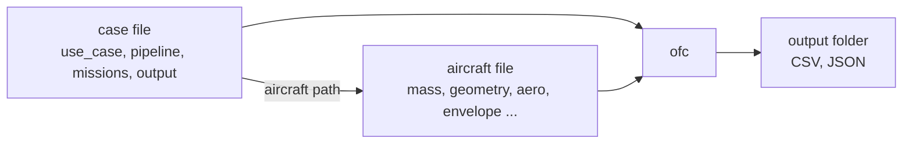

# 3. Input files

An optimisation is described by two JSON files: a **case file**, which holds the missions and every setting of the run, and an **aircraft file**, which holds the design data of the aircraft. This chapter documents both for the optimisation use case (UC-08) and the benchmark (UC-09). The keys of the other use cases are listed in [Use cases: input reference](../code/use-cases.md).



## 3.1 Conventions

| Topic | Convention |
|---|---|
| Units | SI: metres, seconds, kilograms, newtons, watts |
| Angles | Degrees in every input key, and those keys end in `_deg` or `_dps` (degrees per second). Radians inside the code |
| Horizontal position | Local flat-Earth frame, in metres, written `[north, east]` |
| Heading | Degrees clockwise from north: 0 = north, 90 = east, 180 = south, -90 or 270 = west |
| Altitude | Metres, positive up. The code uses north-east-down (NED) axes internally, so its `z` is `-h` |
| Paths to files | Relative to the folder the program is started from (normally `code/`) |
| Comments | `//` and `/* */` comments are accepted in case files. Aircraft files must be strict JSON |
| Missing keys | Optional keys take the documented default. Unknown keys are ignored, so a misspelt key silently falls back to its default: check the spelling when a setting seems to have no effect |

The flight takes place in still air: UC-08 and UC-09 have no wind input.

## 3.2 The case file

A UC-08 case file has five top-level keys:

```json
{
  "use_case": "UC-08",
  "aircraft": "data/aircraft/generic_uav.json",
  "pipeline": { ... },
  "missions": [ { ... }, { ... } ],
  "output": "output/my_case"
}
```

| Key | Required | Meaning |
|---|:---:|---|
| `use_case` | ✓ | `"UC-08"` for optimal missions, `"UC-09"` for the benchmark |
| `aircraft` | ✓ | Path of the aircraft file |
| `pipeline` | | Seed, stages, cost weights, node counts, planner and solver settings (section 3.4). Every key has a default |
| `missions` | ✓ | List of missions (section 3.3). Each one is solved independently with the same settings |
| `output` | | Output folder. Default `output/uc08` (UC-08) or `output/uc09` (UC-09) |

The smallest valid case file uses every default: a 25 m/s cruise at 300 m from the origin, heading north, to a point 3 km north, minimising fuel.

```json
{
  "use_case": "UC-08",
  "aircraft": "data/aircraft/generic_uav.json",
  "missions": [ { "id": "M-00", "end": [3000, 0] } ],
  "output": "output/minimal"
}
```

## 3.3 Missions

Each element of `missions` describes one flight from a start pose to a goal pose. The same description feeds the planner, the guidance laws and both optimal-control problems.

### Keys

| Key | Unit | Default | Meaning |
|---|---|---|---|
| `id` | text | `"SC"` | Identifier, used in the console table and in the output file names. Give each mission a unique one |
| `title` | text | `id` | Free description, written to `report.json` |
| `h0_m` | m | 300 | Initial altitude |
| `climb_m` | m | 0 | Altitude change. Final altitude = `h0_m + climb_m`; negative values describe a descent |
| `V_mps` | m/s | aircraft `V_cruise` | Initial airspeed (a fixed boundary condition) and commanded speed of the warm start |
| `bank_deg` | deg | ¾ of `phi_max_deg` | Bank angle used by the warm start: it sets the planner's turn radius and limits the guidance |
| `gamma_deg` | deg | ½ of `gamma_max_deg` | Largest flight-path angle the guidance uses to climb or descend |
| `start` | m | `[0, 0]` | Start position `[north, east]` |
| `start_heading_deg` | deg | 0 | Initial heading |
| `end` | m | required | Goal position `[north, east]` |
| `end_heading_deg` | deg | 0 | Final heading |
| `nfz` | | none | List of no-fly zones (below) |
| `waypoints` | | none | List of waypoints, visited in the order given (below) |

### What is fixed and what is free

The optimiser does not choose the start or the goal; it chooses everything in between, including the flight time.

| Quantity | At the start | At the end |
|---|---|---|
| Position and altitude | Fixed: `start`, `h0_m` | Fixed: `end`, `h0_m + climb_m` |
| Heading | Fixed: `start_heading_deg` | Fixed: `end_heading_deg` (any multiple of 360° is accepted) |
| Airspeed | Fixed: `V_mps` | Free |
| Flight-path angle, bank | Fixed: level, wings level | Free |
| Mass | Fixed: take-off mass `m0_kg` | Free (it is what minimum fuel maximises) |
| 6-DoF attitude, rates, controls | Fixed: wings-level trim at `V_mps` and `h0_m` | Free |

`bank_deg` and `gamma_deg` only shape the warm start. The optimiser itself is limited by the aircraft envelope (`phi_max_deg`, `gamma_min_deg`, `gamma_max_deg`), so the optimum may bank or climb more steeply than the warm start did.

### No-fly zones

```json
"nfz": [
  { "id": "TOWN", "polygon": [[1200, -400], [2000, -400], [2000, 500], [1200, 500]],
    "h_min_m": 0, "h_max_m": 1500, "margin_m": 40 }
]
```

| Key | Unit | Default | Meaning |
|---|---|---|---|
| `id` | text | `"NFZ"` | Name, used in the constraint labels (`nfz:TOWN`) |
| `polygon` | m | required | At least three vertices `[north, east]`, in either orientation. The polygon must be simple: its edges may not cross |
| `h_min_m`, `h_max_m` | m | 0, 10⁹ | Altitude band of the zone; `h_max_m` must be greater than `h_min_m` |
| `margin_m` | m | 0 | Required horizontal distance from the polygon |

A zone is a vertical prism: the polygon extruded from `h_min_m` to `h_max_m`. It is **active** for a mission if its band overlaps the altitudes the mission spans, from `h0_m` to `h0_m + climb_m`. An inactive zone is ignored everywhere, so the aircraft may fly over it (see mission M-04 in UC-08). The decision is taken once per mission, not per node, because a constraint that switches on and off with altitude would be discontinuous.

Three distances are involved, from the inside out:

1. `margin_m`, the distance the trajectory must keep. The verification checks it along the whole optimal path.
2. The margin the optimiser enforces at the nodes, slightly larger so that the straight segments between nodes also keep `margin_m` (section 7.5).
3. `margin_m + safety_m` (planner setting, default 10 m), the distance the warm-start path keeps.

### Waypoints

```json
"waypoints": [ { "id": "WP1", "position": [3000, 1200], "tolerance_m": 40 } ]
```

| Key | Unit | Default | Meaning |
|---|---|---|---|
| `id` | text | `"WP"` | Name, used in the constraint labels (`wp:WP1`) |
| `position` | m | required | `[north, east]` |
| `tolerance_m` | m | 50 | The trajectory must pass within this horizontal distance |

Waypoints are visited in the order listed. They constrain the horizontal position only, not the altitude, speed or heading. A minimum-fuel optimum usually passes on the edge of the tolerance circle, because going closer costs fuel.

### Derived quantities

From a mission, the program derives quantities that you do not enter but will see in the results:

| Quantity | Definition | Used for |
|---|---|---|
| Reference length $L_{ref}$ | Length of the polyline start → waypoints → goal, combined with the altitude change: $\sqrt{L_h^2+\Delta h^2}$ | Scaling of positions, bounds of the flight time, the NFZ margin inflation |
| Reference time $t_{ref}$ | $L_{ref}/V$ with $V$ = `V_mps` | Scaling of the flight time and of the cost |
| Planning radius $R$ | $V^2 / (g\tan(f_b\,\phi_{ws}))$, with $f_b$ = `bank_fraction` and $\phi_{ws}$ = `bank_deg` | Hybrid A\* turn radius |
| Altitude band | $[\min(h_0,h_f), \max(h_0,h_f)]$ | Activity of the no-fly zones |

## 3.4 The pipeline block

```json
"pipeline": {
  "seed": "warm", "stages": "UF>FC", "fc_from_uf": true,
  "nodes_uf": 60, "nodes_fc": 60,
  "alpha": 1.0, "beta_control": 1.0, "beta_state": 1.0,
  "sideslip_max_deg": 1.0, "verify_tol": 1e-4,
  "planner": { "cell_m": 20, "heading_bins": 72, "step_m": 30, "bank_fraction": 0.8, "safety_m": 10 },
  "solver":  { "tol": 1e-6, "acceptable_tol": 1e-4, "max_iter": 1500, "max_cpu_time_s": 120, "print_level": 0 }
}
```

| Key | Default | Meaning | Guidance |
|---|---|---|---|
| `seed` | `"warm"` | `"warm"`: Hybrid A\* path flown by the guidance laws. `"cold"`: straight line from start to goal | Keep `"warm"`. Use `"cold"` only to measure what the warm start is worth |
| `stages` | `"UF>FC"` | Stages to run: `"UF>FC"`, `"UF"` or `"FC"` | `"UF"` is fast and enough for most planning studies; add `FC` when attitude, rates or surface deflections matter |
| `fc_from_uf` | `true` | Seed the FC stage with the UF optimum. If `false`, or if the UF stage failed, FC is seeded by the warm start | Keep `true` |
| `nodes_uf`, `nodes_fc` | 60, 60 | Collocation nodes $N$ of each stage | The bundled 3–4 km missions use 60 nodes, one every 50–70 m of path. More nodes resolve turns better and cost more time (section 6.10) |
| `alpha` | 1.0 | Cost weight: 0 = minimum time, 1 = minimum fuel, values in between trade one against the other | See the tutorial (chapter 5) for the effect |
| `beta_control` | 1.0 | Weight of the control-smoothness penalty | 1 keeps the penalty at 0–1 % of the cost. Values near 0 give bang-bang thrust |
| `beta_state` | 1.0 | Weight of the attitude-smoothness penalty (flight-path angle and bank for UF, roll and pitch for FC) | As above |
| `sideslip_max_deg` | 1.0 | FC sideslip limit, degrees | Keep it small. A large value lets the 6-DoF model use side force as free lift (section 7.4) |
| `verify_tol` | 10⁻⁴ | Tolerance of the post-solve verification. Constraint rows are normalised, so this is a relative tolerance | Rarely changed |
| `planner` | | Hybrid A\* settings (below) | |
| `solver` | | IPOPT settings (below and chapter 8) | |

### Planner settings

| Key | Default | Meaning |
|---|---|---|
| `cell_m` | 20 | Size of the search grid cells, metres |
| `heading_bins` | 72 | Number of heading cells (72 = 5° each) |
| `step_m` | 30 | Length of one motion primitive, metres |
| `bank_fraction` | 0.8 | Fraction of `bank_deg` used to compute the planning radius. The rest is left to the guidance to correct tracking errors |
| `safety_m` | 10 | Distance added to every zone margin by the planner |

A finer grid (`cell_m`, `heading_bins`) finds paths through narrower gaps but expands more search nodes. If the planner finds no path, a smaller `safety_m`, a finer grid or a larger `bank_fraction` (tighter planned turns, less bank left for the guidance) usually helps.

### Solver settings

| Key | Default | Meaning |
|---|---|---|
| `tol` | 10⁻⁶ | Convergence tolerance of IPOPT |
| `acceptable_tol` | 10⁻⁴ | Looser tolerance: IPOPT stops with status `acceptable` if it stays below it for several iterations without reaching `tol` |
| `constr_viol_tol` | 10⁻⁶ | Largest constraint violation accepted at convergence |
| `max_iter` | 1500 | Iteration limit |
| `max_cpu_time_s` | 120 | Time limit per stage, seconds |
| `print_level` | 0 | IPOPT console output: 0 silent, 5 one line per iteration, up to 12 |
| `mu_strategy` | `"adaptive"` | Update rule of the barrier parameter: `"adaptive"` or `"monotone"` |
| `lbfgs_history` | 6 | Number of correction pairs kept by the limited-memory Hessian approximation |
| `linear_solver` | IPOPT's default | Sparse linear solver, for example `"mumps"`, or `"ma27"`/`"ma57"` if IPOPT was built with the HSL routines |
| `derivative_test` | `false` | Run IPOPT's first-order derivative checker at the initial point |

Chapter 8 explains each option, when to change it and how to read the output.

## 3.5 Benchmark case files (UC-09)

A UC-09 case file has the same `aircraft`, `pipeline`, `missions` and `output` keys, plus:

| Key | Default | Meaning |
|---|---|---|
| `pipelines` | `["COLD>UF", "WS>UF", "WS>FC", "WS>UF>FC"]` | Pipelines to compare. Each label is a seed (`WS` = warm start, `COLD` = straight line) followed by the stages |
| `repeats` | 1 | Runs per pipeline and mission; the fastest is kept, to reduce timing noise |

Each label overrides `seed`, `stages` and `fc_from_uf` of the `pipeline` block. All pipelines solve exactly the same problem for a given mission: the scales, the cost references and the bounds of the flight time are computed from the mission, never from the seed.

## 3.6 The aircraft file

The aircraft file groups the design data. The full list of fields, with units, is in [Aircraft file format](../code/aircraft-format.md); the bundled example is [`data/aircraft/generic_uav.json`](https://github.com/pablourioste/uavtraj-opt/blob/main/code/data/aircraft/generic_uav.json), an 11 kg UAV with a 2.9 m span.

| Group | Content | Where it enters the optimisation |
|---|---|---|
| `mass` | Take-off, empty and fuel mass | Initial mass; lower bound of the mass |
| `geometry` | Wing area, span, mean chord | Aerodynamic forces and moments |
| `inertia` | Body-axis inertia | FC rotational dynamics |
| `propulsion` | Sea-level power, propeller efficiency, specific fuel consumption, thrust-line offset | Available thrust and power constraint; fuel flow |
| `envelope` | Speeds, minimum altitude, load factors, bank, pitch, flight-path and incidence limits | Path constraints of both problems |
| `actuators` | Surface deflection limits, body-rate limits | FC control bounds and rate constraints; UF bank-rate constraint |
| `aero` | Lift, drag polar, side force, roll, pitch and yaw derivatives | FC uses all of them; UF uses the drag polar and the maximum lift coefficient |

The loader stops with a message that names the field when a required value is missing or inconsistent. It checks that:

- `m_empty_kg + fuel_max_kg` does not exceed `m0_kg`, and all masses, lengths and inertias are positive;
- the inertia tensor is positive definite ($I_{xx}I_{zz}-I_{xz}^2>0$);
- `eta_p` lies in (0, 1];
- `alpha_min_deg < alpha_max_deg`, and `n_min < 1 < n_max`;
- the lift slope and the induced-drag factor are positive, and $C_L$ at `alpha_max_deg` is positive;
- $C_{m\alpha}<0$ (static stability in pitch);
- the stall speed at sea level is below `V_ne`.

Quantities such as the maximum lift coefficient, the stall speed at each altitude and mass, the available thrust and the best lift-to-drag speed are always derived from these data, never entered.

**Checking a new aircraft.** Point the case files of UC-01 and UC-05 at the new file and run them before any optimisation. UC-01 prints the derived performance; UC-05 draws the power curves, the flight envelope and the trim curves, which reveal unrealistic coefficients quickly (for example an elevator that cannot trim the aircraft at cruise speed).

## 3.7 Checklist before running a new case

1. The `end` position and both headings describe the mission you intend: north first, east second; heading clockwise from north.
2. Every zone polygon is simple and its altitude band is the one you mean. A zone below the whole flight is ignored.
3. Waypoints are listed in visiting order, and each tolerance is reachable with the aircraft's turn radius.
4. The start and goal are outside every active zone plus its margin.
5. `V_mps` lies between the stall speed and `V_ne` at `h0_m` (UC-01 prints both).
6. `nodes_uf` and `nodes_fc` are large enough for the path length (section 6.10).
7. The output folder is new, or you do not mind overwriting its contents.

[← 2. First run](02-first-run.md) · [Next: 4. Reading the results →](04-results.md)
