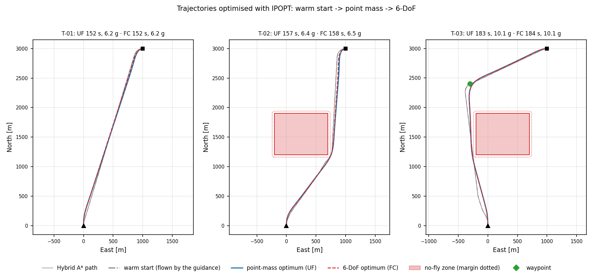
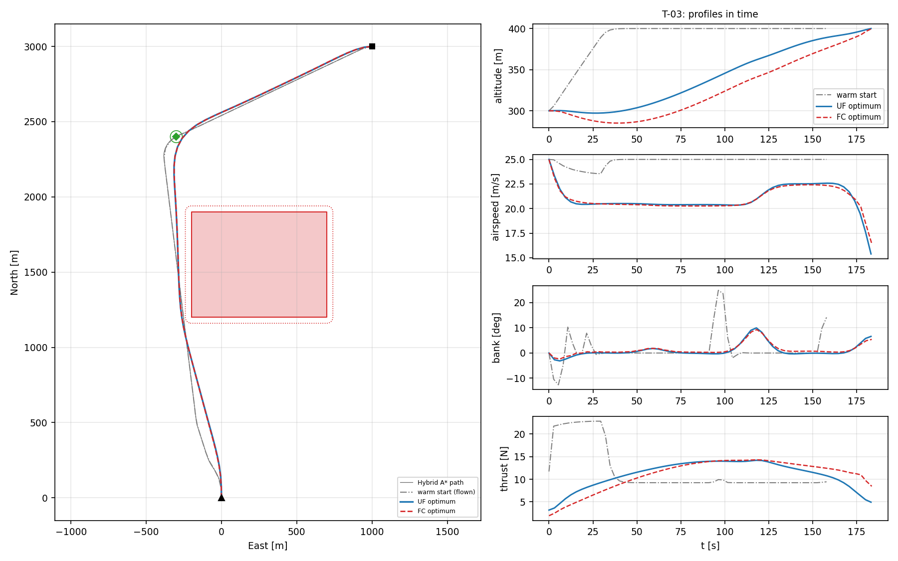

# 5. Tutorial: your first mission

This tutorial builds a mission in three steps, runs the full optimisation on each one, and then changes the cost to see how the optimum responds. Every number below was produced with [`data/cases/tutorial_first_mission.json`](https://github.com/pablourioste/uavtraj-opt/blob/main/code/data/cases/tutorial_first_mission.json) on a Windows laptop with IPOPT 3.14.20; your iteration counts and times will differ slightly.

**The task.** The generic UAV of the repository flies at 300 m and 25 m/s, heading north from the origin. It must reach a point 3 km north and 1 km east, arriving on an easterly heading. We first solve it in empty airspace, then add a no-fly zone on the direct route, then add a waypoint and a 100 m climb.

## 5.1 Step 1: empty airspace (T-01)

The case file starts with the use case, the aircraft and the pipeline settings. The values below are the defaults written out in full, so that every setting is visible:

```json
"use_case": "UC-08",
"aircraft": "data/aircraft/generic_uav.json",
"pipeline": {
  "seed": "warm", "stages": "UF>FC",
  "nodes_uf": 60, "nodes_fc": 60,
  "alpha": 1.0, "beta_control": 1.0, "beta_state": 1.0, "sideslip_max_deg": 1.0,
  "planner": { "cell_m": 20, "heading_bins": 72, "step_m": 30, "bank_fraction": 0.8, "safety_m": 10 },
  "solver": { "tol": 1e-6, "acceptable_tol": 1e-4, "max_iter": 1500, "max_cpu_time_s": 120, "print_level": 0 }
},
```

In words: seed the optimisation with the warm start, solve the point-mass problem and then the 6-DoF problem on 60 nodes each, minimise fuel (`alpha` = 1) with the standard smoothness penalties, and keep the 6-DoF model in coordinated flight.

The first mission only states the start and the goal:

```json
{
  "id": "T-01", "title": "Empty airspace",
  "h0_m": 300, "climb_m": 0, "V_mps": 25, "bank_deg": 30,
  "start": [0, 0], "start_heading_deg": 0, "end": [3000, 1000], "end_heading_deg": 90
}
```

`bank_deg` sets the turn radius of the warm start: $R = V^2/(g\tan(0.8\cdot 30°)) = 143$ m. It does not limit the optimiser, which may bank up to the aircraft's `phi_max_deg` (40°).

## 5.2 Step 2: a no-fly zone on the direct route (T-02)

T-02 is T-01 with one zone added. The square covers north 1200 to 1900 m and east -200 to 700 m, from the ground to 1000 m, with a 40 m margin. The straight line from the start to the goal passes through it.

```json
"nfz": [
  { "id": "Z1", "polygon": [[1200, -200], [1900, -200], [1900, 700], [1200, 700]],
    "h_min_m": 0, "h_max_m": 1000, "margin_m": 40 }
]
```

## 5.3 Step 3: a waypoint and a climb (T-03)

T-03 keeps the zone, asks the aircraft to pass within 40 m of a point west of it, and to arrive 100 m higher:

```json
"climb_m": 100,
"waypoints": [ { "id": "WP1", "position": [2400, -300], "tolerance_m": 40 } ]
```

## 5.4 Run

```bash
./build/ofc data/cases/tutorial_first_mission.json
```

```text
id     | WS[ms] | UF           it   t[ms]  tf[s] fuel_g pen% | FC           it   t[ms]  tf[s] fuel_g pen% | clrUF clrFC  wpUF  wpFC  simUF
T-01   |     36 | solved      116     539  152.1    6.2    1 | solved      113     743  152.4    6.2    1 |     -     -     -     -   0.72
T-02   |    171 | solved       99     509  156.9    6.4    1 | solved      116     964  157.5    6.5    1 |     9     9     -     -   1.00
T-03   |    162 | solved      106    2331  183.2   10.1    1 | solved      122    3726  183.6   10.1    1 |    23    22  39.1  39.1   0.48
```

Go through the checklist of section 4.8:

1. All six stages are `solved`, none is marked with `!`, so every stage converged and passed the verification.
2. The optimal paths keep 9 m (T-02) and 22–23 m (T-03) beyond the 40 m margin, measured along the segments between nodes. In T-03 the waypoint is passed 39.1 m from its centre, inside the 40 m tolerance.
3. `simUF` is under 1 m, against a node spacing of about 55–65 m.
4. The smoothness penalties are about 1 % of the cost.
5. The point-mass and 6-DoF optima agree to 0.4 % in flight time and to 0.1 g in fuel.

## 5.5 Plot

```bash
python utils/plot_results.py --optimal output/tutorial
```

The figures are written to `output/figures/tutorial_cover.png` and `tutorial_T-01.png` to `tutorial_T-03.png`.



*Black: Hybrid A\* path. Grey dash-dot: warm start flown by the guidance. Blue: point-mass (UF) optimum. Red dashed: 6-DoF (FC) optimum. Red square: the no-fly zone, with its margin dotted. Green diamond: the waypoint with its tolerance circle.*

## 5.6 Interpretation

**T-01.** With nothing in the way, the optimum is almost a straight line followed by a turn onto the final heading. The path is 3.20 km long against 3.16 km for the straight line between the end points, because the aircraft must turn from north to east. The flight takes 152 s, so the mean ground speed is about 21 m/s, not the 25 m/s the aircraft started with: to minimise fuel it slows down to about 21 m/s, its best lift-to-drag speed (20.8 m/s at sea level, UC-01), and stays there.

**T-02.** The zone forces a detour round its east side. The optimum hugs the corner of the margin more closely than the warm start, which kept the planner's extra 10 m of safety distance. The detour costs 4.8 s and 0.2 g of fuel (3 %).

**T-03.** The waypoint lies west of the zone, so the path now passes on the west side and then turns north-east to the goal.



The profiles show the difference between a flyable trajectory and an optimal one:

- **Altitude.** The warm start climbs the 100 m at once, at its commanded 7.5° climb angle, then cruises. Both optima instead stay low at first and spread the climb over the whole flight.
- **Airspeed.** The warm start holds 25 m/s. The optima slow to about 20.5 m/s, and in the last seconds bleed speed down to about 15 m/s, close to the stall speed, because the final speed is free and kinetic energy left at the goal would be fuel wasted.
- **Thrust.** The warm start needs 23 N during its climb, near the power limit. The optima use a smooth thrust profile that never exceeds 15 N.
- **Fuel.** T-03 burns 10.1 g against 6.4 g for T-02. Most of the difference is the potential energy of the climb: $mg\Delta h$ = 11 kg × 9.81 m/s² × 100 m = 10.8 kJ, which at the aircraft's propeller efficiency (0.7) and specific fuel consumption (0.6 kg/kWh) costs 2.6 g. The longer path (183 s against 157 s) accounts for the rest.

The two models time the climb differently (the 6-DoF optimum first descends about 15 m before climbing) but burn the same fuel: for this propulsion model, the fuel cost of a climb hardly depends on when it is flown.

## 5.7 Change the objective

Edit `"alpha"` in the `pipeline` block and run again. `alpha` = 0 minimises flight time, 1 minimises fuel, and 0.5 weighs both (each term is normalised by its own reference, so the weights are comparable; section 7.7). Point-mass results:

| Mission | α = 1 (fuel) | α = 0.5 | α = 0 (time) |
|---|---|---|---|
| T-01 | 152.1 s, 6.2 g | 101.1 s, 8.7 g | 87.7 s, 11.4 g |
| T-02 | 156.9 s, 6.4 g | 104.1 s, 9.0 g | 90.4 s, 11.7 g |
| T-03 | 183.2 s, 10.1 g | 121.8 s, 13.2 g | 113.7 s, 14.6 g |

Minimum time cuts the flight time by 40 % and nearly doubles the fuel. The minimum-time T-01 also shows how the optimiser uses every freedom it has:

- It accelerates from 25 m/s to 39 m/s, just below the never-exceed speed of 40 m/s, in a shallow dive. At that speed the thrust (14 N) is limited by the available power, so the power constraint is active.
- It descends about 70 m below the start altitude to gain speed, and zooms back up to the required final altitude in the last 15 seconds, trading kinetic energy for height while it banks 35° onto the final heading.
The minimum-time UF solves also needed fewer iterations here: 35 to 39, against 99 to 116 for minimum fuel.

The intermediate value α = 0.5 gives about four fifths of the time saving for about half of the extra fuel, which is the kind of trade-off the weight is for.

## 5.8 Exercises

Each of these changes one setting of a copy of the tutorial file; compare the console table with the one in section 5.4. The outcomes quoted were obtained on the same machine.

1. **Point mass only.** Set `"stages": "UF"`. The UF columns are unchanged and the FC columns show `-`. The run is much faster, and for planning studies the point-mass optimum is usually enough.
2. **Cold start.** Set `"seed": "cold"`. The UF stage now starts from a straight line through the zone. T-01 and T-02 still reach the same optima, with more iterations for T-02 (128 against 99). T-03 converges to a different, worse local optimum: 229 s and 12.1 g instead of 183 s and 10.1 g. This is the situation the warm start exists to avoid (section 6.1).
3. **Watch IPOPT.** Set `"print_level": 5` in the `solver` block and run T-02 alone (delete the other missions from your copy). Chapter 8 explains every column of the log.
4. **Number of nodes.** Set `"nodes_uf": 25`. The UF solves become several times faster, but `simUF` grows from under 1 m to 4–7 m, and the clearance grows to 47–70 m because the zone margin is inflated more to protect the longer segments between nodes (section 7.5). With `"nodes_uf": 120`, `simUF` drops to 0.1–0.2 m, the clearance shrinks to 3–6 m and the optimum improves slightly (151.5 s instead of 152.1 s for T-01), at a higher cost per iteration.
5. **A tighter waypoint.** Reduce `tolerance_m` of WP1 to 10 m and observe the extra time and fuel needed to pass closer.
6. **A second zone.** Add a zone between the start and WP1 and check that both clearances stay positive.

Save your changes in a new file such as `data/cases/my_mission.json`, not in the bundled ones. Avoid the `uc0` prefix, so that `run.sh` keeps running only the bundled cases.

[← 4. Reading the results](04-results.md) · [Next: 6. The optimisation process →](06-optimisation-process.md)
