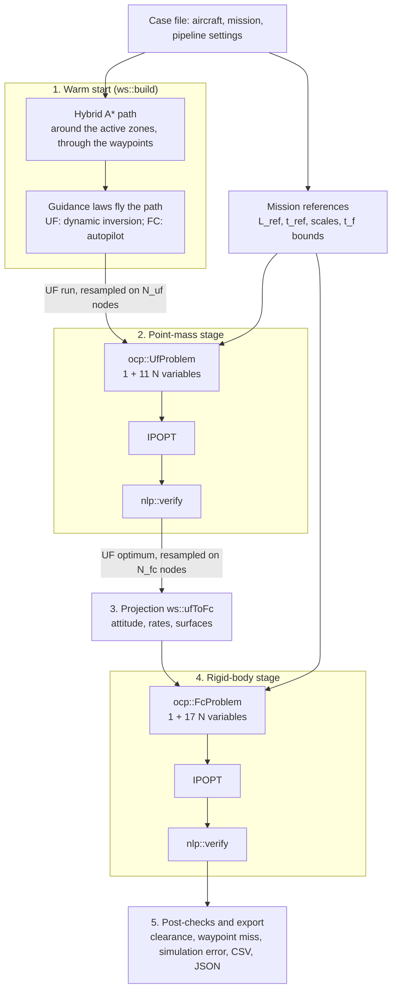

# 6. The optimisation process

This chapter follows one mission through the program, from the case file to the verified optimum: what each stage computes, what it passes to the next one, and why the stages are arranged this way. The equations behind each step are in chapter 7, and the solver itself in chapter 8.

## 6.1 Why the optimisation is staged

Trajectory optimisation is solved here as a large nonlinear program (NLP): thousands of variables and constraints, a nonconvex feasible set (no-fly zones, nonlinear dynamics) and a cost with several local minima. IPOPT, like every gradient-based solver, converges to a local optimum near its initial point, and how quickly and reliably it does so depends heavily on that point.

Two facts follow:

1. **A good initial point matters more than any solver option.** A straight line from start to goal violates the equations of motion (it has zero controls), may cross the no-fly zones, and ignores the final heading. IPOPT must first repair all of this, and may end in a poor local optimum or fail. The thesis measured exactly this: without a warm start, the point-mass problem was infeasible in 3 of its 8 scenarios ([14. Warm-start benchmark](../14-results-warmstart.md)). Exercise 2 of the tutorial shows a milder version with the generic UAV: a cold start ends 25 % slower and 20 % heavier on fuel in mission T-03.
2. **A cheap model can prepare an expensive one.** The point-mass model has 8 states and an analytic Jacobian; the 6-DoF model has 13 states and a numerical one. Solving the point-mass problem first, and projecting its optimum into 6-DoF states, gives the expensive problem a starting point that is already close to optimal.

The pipeline therefore increases the fidelity in steps: a geometric path, a flown trajectory, a point-mass optimum and finally a 6-DoF optimum, each serving as the initial point of the next.

## 6.2 Overview

The whole sequence is `pipeline::run` in [`src/pipeline/pipeline.cpp`](https://github.com/pablourioste/uavtraj-opt/blob/main/code/src/pipeline/pipeline.cpp). It returns a `pipeline::Result` with the warm start, the initial point and the optimum of each stage, and a `Stage` record (status, iterations, time, objective, verification) for each of them.

## 6.3 Before the stages: the mission references

Before anything is solved, the pipeline fixes the quantities that define the size of the problem, all computed from the mission and never from an initial point:

- the reference length $L_{ref}$: the polyline start → waypoints → goal, combined with the altitude change;
- the reference time $t_{ref} = L_{ref}/V$, with $V$ the commanded speed `V_mps`.

They set the scales of the position variables and of the flight time, the bounds of the flight time ($0.3\,t_{ref} \le t_f \le 3\,t_{ref}$) and the normalisation of the cost (chapter 7). Because they do not depend on the seed, a cold start, a warm start and a projected optimum all solve **the same** problem, and their results can be compared directly (UC-09). The only exception is the assignment of waypoints to nodes, which follows the initial point (section 6.5).

## 6.4 Stage 1: warm start

`ws::build` in [`src/warmstart/warm_start.cpp`](https://github.com/pablourioste/uavtraj-opt/blob/main/code/src/warmstart/warm_start.cpp) produces a trajectory that is flyable, avoids the zones and visits the waypoints. It is not optimal, and it is not meant to be.

1. **Turn radius.** $R = V^2/(g\tan(f_b\,\phi_{ws}))$ from the commanded speed, the warm-start bank `bank_deg` and `bank_fraction` $f_b$. For the bundled missions: 25 m/s, 30° and 0.8 give 143 m.
2. **Path planning.** Hybrid A\* searches over cells of position and heading. Its edges are short arcs and straight segments whose curvature never exceeds $1/R$, so every path it returns can be flown at the planning bank. Points along each edge must keep `margin_m + safety_m` from every active zone. A Dubins path (the shortest path with bounded curvature between two poses) serves as heuristic and, when it is collision-free, closes the search early. With waypoints, the mission is planned leg by leg. Details: [Formulation in code, missions with no-fly zones](../code/formulation.md).
3. **Flying the path.** The path is a geometric curve without speeds or timing. Guidance laws fly it with both models, by RK4 integration at 100 Hz:
    - lateral: L1 path following, which aims at a point 2.5 V ahead on the path and commands the bank needed to reach it;
    - vertical: a climb or descent at up to `gamma_deg` towards the final altitude;
    - point mass: the equations of motion are inverted for lift coefficient, thrust and bank rate (dynamic inversion);
    - rigid body: an autopilot around the wings-level trim drives elevator, aileron, rudder and thrust.
4. **Resampling.** The UF run is interpolated in time onto the $N_{uf}$ collocation nodes (`ws::fromRun`).

The flown trajectories satisfy the equations of motion of their model, so their collocation defects are small; they are only nonzero because the mesh is coarser than the integration step. In the tutorial, the warm start's largest normalised defect is 0.22–0.29, against 3.2 for a straight line (`guess_defect_uf` in `summary.csv`).

The warm start **succeeds** if a path is found and the point-mass guidance reaches its end. If it fails, the row is marked `(CHECK)` and the UF stage starts from a straight line instead.

## 6.5 Stage 2: the point-mass problem

1. **Initial point.** The resampled UF run (seed label `warm start (UF guidance run)`), or with `"seed": "cold"` a straight line at constant speed with zero controls (`straight line`).
2. **Mission data.** Start state (position, `V_mps`, level, `start_heading_deg`, wings level, take-off mass), goal position, altitude and heading, cost weights.
3. **No-fly zones.** The margin of every zone is enlarged so that the straight segments between nodes, not only the nodes, keep the requested margin (section 7.5).
4. **Waypoints.** Each waypoint is attached to one node: the node of the initial point nearest to it, searching forward from the previous waypoint's node and leaving room for the remaining waypoints. The waypoint constraint then applies to that node.
5. **Problem.** `ocp::UfProblem` assembles the variables, bounds, constraints, sparse Jacobian and cost (chapter 7).
6. **Solve.** `nlp::solve` calls IPOPT (chapter 8).
7. **Verify.** `nlp::verify` re-evaluates every constraint and bound at the result (section 4.3). The stage succeeds only if IPOPT converged and the verification passed.
8. **Penalty share.** The cost is re-evaluated with the smoothness weights set to zero; the difference is reported as `pen%`.

Because waypoints are attached to fixed nodes, the share of the flight time before each waypoint follows the initial point. With a good warm start this costs little; with a poor initial point it can steer the solver towards a worse optimum, which is one reason the cold start of tutorial mission T-03 ends worse.

## 6.6 Stage 3: projection from point mass to rigid body

`ws::ufToFc` turns the point-mass optimum, resampled on $N_{fc}$ nodes, into 6-DoF states and controls, node by node:

1. The incidence follows from the lift coefficient, and the elevator from the pitching-moment balance. Since the 6-DoF thrust acts along the body axis rather than the velocity, it is $T/\cos\alpha$; three fixed-point passes settle incidence, elevator and thrust together.
2. The attitude is the wind-axis attitude (flight-path angle, heading, bank) rotated by the incidence, with zero sideslip. Roll, pitch and yaw angles are extracted from the resulting rotation matrix.
3. Body rates are obtained from the time derivatives of the Euler angles.
4. Body velocities are $(V\cos\alpha, 0, V\sin\alpha)$.
5. Aileron and rudder cancel the rolling and yawing moments at zero sideslip.

On a trimmed straight line, the projection reproduces the 6-DoF trim to five digits. On a manoeuvring trajectory its defects are larger (2.7–4.9 in the tutorial), because the point mass has no rotational dynamics, but the trajectory is already close to the 6-DoF optimum in position, speed and timing.

## 6.7 Stage 4: the rigid-body problem

The FC stage is seeded by the first available option:

| Condition | Initial point | Seed label in `report.json` |
|---|---|---|
| `fc_from_uf` is true and the UF stage succeeded | The projected UF optimum | `UF optimum (projected)` |
| Otherwise, the warm start succeeded and the FC autopilot reached the goal | The FC run of the warm start, resampled | `warm start (FC autopilot run)` |
| Otherwise, the warm start succeeded | The UF run of the warm start, projected | `warm start (UF guidance run, projected)` |
| Otherwise (cold start) | A straight line with every node at the wings-level trim | `straight line (trimmed)` |

The initial state is the 6-DoF wings-level trim at `V_mps` and `h0_m`, placed at the start position and heading. The end conditions, zones, waypoints and cost weights are those of the UF stage, plus the sideslip limit `sideslip_max_deg`. The problem is `ocp::FcProblem`; it is solved and verified in the same way as the UF stage.

## 6.8 Post-checks

The constraints of the NLP hold at the nodes. After the solve, the pipeline measures the optimum more finely:

| Check | How | Reported as |
|---|---|---|
| Zone clearance | Distance beyond the margin of every active zone, at ten points per segment between nodes | `clrUF`, `clrFC` |
| Waypoint miss | Smallest distance from each waypoint to the path, at eleven points per segment | `wpUF`, `wpFC` |
| Discretisation error (UF) | Each interval simulated with RK4 (step ≤ 0.01 s) from its starting node, with the optimal controls interpolated linearly; distance to the next node | `simUF` |

## 6.9 Inside one solve

Each IPOPT call repeats the same loop until its convergence test is met (details in chapter 8):

1. Evaluate the cost, its gradient, the constraints and their sparse Jacobian at the current point. These are the only things the formulation provides; IPOPT never sees the aircraft, only these numbers.
2. Update a limited-memory approximation of the second derivatives from the last few gradient changes.
3. Solve one sparse linear system (the Newton step of the barrier problem) for a search direction.
4. Choose a step length along that direction that reduces either the cost or the constraint violation (filter line search).
5. Reduce the barrier parameter when the current barrier problem is solved accurately enough.

The IPOPT log of the UF stage of mission M-01 shows the typical course of a warm-started solve:

- In the first ten iterations the barrier parameter stays at about 0.5, and IPOPT reduces the largest constraint violation from 0.3 to 0.004, accepting a higher cost on the way (0.46 to 1.56).
- The adaptive barrier update then lowers $\mu$ quickly, though not monotonically, to its floor of $10^{-11}$ by iteration 42, while the cost falls to 0.390.
- The remaining iterations refine the solution: the cost changes only in its fourth digit, and the solve stops at iteration 100 with a constraint violation of $4\cdot10^{-9}$ and a dual infeasibility of $9\cdot10^{-7}$, both below the tolerance of $10^{-6}$.

Chapter 8 reproduces this log and explains each column.

## 6.10 Choosing the pipeline settings

| Decision | Recommendation |
|---|---|
| Seed | Always `warm`. `cold` is only useful to measure the value of the warm start |
| Stages | `UF` for route studies, quick trade-offs and many missions. `UF>FC` when attitudes, body rates or control-surface deflections matter, or to confirm the point-mass result with the full model |
| Nodes | Enough to resolve the turns. For the bundled 3–4 km missions, 60 nodes (one every 50–70 m) keep `simUF` under 1 m. Check `simUF` and refine if it is large compared with your accuracy needs. The cost of one iteration grows roughly linearly with N |
| `alpha` | 1 for minimum fuel, 0 for minimum time; intermediate values trade one against the other (tutorial, section 5.7) |
| `beta_control`, `beta_state` | Keep 1 unless `pen%` exceeds a few percent. Values near 0 give bang-bang thrust and saw-tooth altitude profiles in minimum-fuel problems |
| `sideslip_max_deg` | Keep 1°. It enforces coordinated flight, which the linear aerodynamic model needs to give physically meaningful 6-DoF optima |
| Solver options | The defaults suit these problems. Chapter 8 lists when to change them |

For a fair comparison of seeds or stage sequences on your own missions, use UC-09 with the pipelines you want to compare (section 3.5).

[← 5. Tutorial](05-tutorial.md) · [Next: 7. Mathematical formulation →](07-formulation.md)
