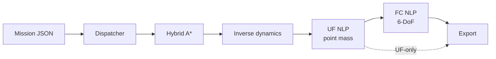

# Optimal 3D Trajectory Planning for a Fixed-Wing UAV

<figure markdown>
  { width="100%" }
  <figcaption>Four missions planned around no-fly zones and through waypoints, then flown by a point-mass and a 6-DoF model of a generic UAV, using the public code. The dotted straight line is what a cold start would try: it crosses the zones.</figcaption>
</figure>

Documentation of a Bachelor's thesis (UPC – ESEIAAT) carried out with **CIMNE** and in collaboration with **Singular Aircraft**: a 3D trajectory optimiser for the amphibious heavy UAV **Flyox I**, built on trapezoidal direct collocation and IPOPT, and accelerated by a Hybrid A\* warm-start chain.

## Missions around no-fly zones

A Hybrid A\* planner finds a flyable path around the active no-fly zones and through the waypoints, and both aircraft models fly it in closed loop. All four missions use a generic UAV at 25 m/s with 30° of bank, which gives a planning turn radius of 143 m.

| Mission | Setting | Planned path | Flight time UF / FC | Clearance beyond the 40 m margin | Waypoint miss | Straight-line cold start |
|---|---|---:|---:|---:|---:|---|
| M-01 | One no-fly zone on the direct route | 3.20 km | 128.0 / 128.0 s | 11 / 11 m | – | 394 m inside the zone |
| M-02 | Slalom between two zones | 3.75 km | 150.0 / 149.9 s | 12 / 12 m | – | 200 m inside a zone |
| M-03 | Two waypoints | 4.31 km | 172.4 / 172.2 s | – | 1.1 / 1.0 m | – |
| M-04 | Zone + waypoint + 150 m climb; a low zone is overflown | 3.92 km | 159.3 / 157.8 s | 16 / 16 m | 0.8 / 0.7 m | 316 m inside the zone |

- **Every mission is flown clear of every zone.** Every waypoint is passed well inside its tolerance.
- **The cold start would be infeasible.** A straight line runs 200–394 m deep into a zone. This is why the thesis's cold-start solver failed in its no-fly-zone and waypoint scenarios ([14. Warm-start benchmark](14-results-warmstart.md)).
- **These are flyable reference paths, not optima.** They are the kind of warm start the thesis hands to its optimiser, and the optimiser is not part of the public code.

Each mission in detail: [Worked examples → UC-07](code/examples.md#uc-07-missions-with-no-fly-zones-and-waypoints).

!!! note "About the code"
    This work was designed exclusively as a product for [Singular Aircraft](https://singularaircraft.com/inicio). For privacy reasons towards the company, the full software repository cannot be shared. What can be shared is the knowledge: the research, the mathematical methods and their application in code. That is what these pages document, through equations, diagrams, pseudocode and results. The repository also includes a **restricted public edition of the code** (`code/`): a generic aircraft, the dynamic models, the collocation formulation, the planner and runnable examples. See [Code: public edition](code/index.md).

## Deeper results

| If you want… | Start at |
|---|---|
| Each mission in detail | [Worked examples → UC-07](code/examples.md#uc-07-missions-with-no-fly-zones-and-waypoints) |
| The thesis numbers (real aircraft, optimiser) | [14. Warm-start benchmark](14-results-warmstart.md) → [15. Conclusions](15-conclusions.md) |
| What was asked and why it is hard | [1. Problem and requirements](01-problem.md) |
| How the solver is built | [5. OCP and NLP](05-ocp-theory.md) → [11. Warm start](11-warm-start.md) |
| Why the published timings are conservative | [Derivatives: v1 and v2](derivatives.md) |
| The generic aircraft's design charts and scenarios | [Worked examples](code/examples.md#uc-05-design-charts) |
| Run it yourself | [Code: public edition](code/index.md) |
| The one-minute version | [README](https://github.com/pablourioste/uavtraj-opt#readme) |

## The idea in one picture

A cheap geometric search provides a path; inverse dynamics turns it into a dynamically plausible guess; a fast point-mass optimisation refines it; a projection seeds the full 6-DoF optimisation. Each step hands the next one a better starting point, which is what makes the interior-point solver converge reliably. The missions above show the first step (the path) working with the public code.

## Full thesis

The complete thesis is available as a PDF in the repository: `thesis/Optimal_3D_Trajectory_Planning_Thesis_Urioste.pdf`.

[Next: Problem and requirements →](01-problem.md)
