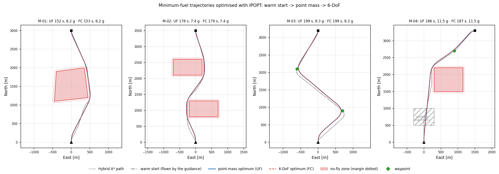
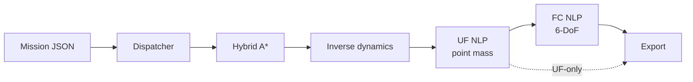

# Optimal 3D Trajectory Planning for a Fixed-Wing UAV

<figure markdown>
  { width="100%" }
  <figcaption>Four minimum-fuel missions of a generic UAV, optimised with IPOPT by the public code. A Hybrid A* path flown by guidance laws (grey) seeds the point-mass optimum (blue), which seeds the 6-DoF optimum (red dashed).</figcaption>
</figure>

Documentation of a Bachelor's thesis (UPC – ESEIAAT) carried out with **CIMNE** and in collaboration with **Singular Aircraft**: a 3D trajectory optimiser for the amphibious heavy UAV **Flyox I**, built on trapezoidal direct collocation and IPOPT, and accelerated by a Hybrid A\* warm-start chain.

## Optimal missions around no-fly zones

The public code runs the whole method on a generic UAV:

1. A Hybrid A\* path around the active no-fly zones and through the waypoints is flown by guidance laws.
2. That flown trajectory seeds the point-mass (UF) optimal-control problem, solved with IPOPT.
3. The UF optimum, projected to 6-DoF states, seeds the rigid-body (FC) problem, solved with IPOPT.
4. Every optimum is re-checked against all its constraints outside the solver.

| Mission | Setting | Optimal path | Flight time UF / FC | Fuel UF / FC | Clearance beyond the 40 m margin | IPOPT iterations UF / FC |
|---|---|---:|---:|---:|---:|---:|
| M-01 | One no-fly zone on the direct route | 3.20 km | 152.3 / 152.5 s | 6.21 / 6.21 g | 9 / 9 m | 116 / 85 |
| M-02 | Slalom between two zones | 3.75 km | 178.4 / 178.7 s | 7.36 / 7.36 g | 11 / 11 m | 115 / 90 |
| M-03 | Two waypoints | 4.15 km | 199.1 / 199.2 s | 8.25 / 8.26 g | – | 121 / 193 |
| M-04 | Zone + waypoint + 150 m climb; a low zone is overflown | 3.91 km | 185.8 / 186.6 s | 11.55 / 11.54 g | 12 / 12 m | 103 / 131 |

- **Every stage converges and passes the independent verification.** The whole optimal path, segments between nodes included, stays clear of every zone, and every waypoint is passed within its tolerance.
- **Both models agree** to 0.5 % in flight time and 0.2 % in fuel, as they should for the same aircraft flying coordinated turns.
- **Each stage solves in 0.5–1.5 s** (machine-dependent). A straight-line cold start also converges for this small aircraft, but more slowly and sometimes into a worse optimum ([UC-09](code/examples.md#uc-09-warm-start-benchmark)).

Each mission in detail: [Worked examples → UC-08](code/examples.md#uc-08-optimal-missions).

!!! note "About the code"
    This work was designed exclusively as a product for [Singular Aircraft](https://singularaircraft.com/inicio). For privacy reasons towards the company, its software repository cannot be shared, and nothing from it is here. What can be shared is the knowledge: the research, the mathematical methods and their application in code. That is what these pages document, through equations, diagrams, pseudocode and results. The repository also includes a **clean-room implementation** (`code/`), written from the thesis equations: a generic aircraft, the dynamic models, the collocation problems, the warm start and its own optimisation pipeline with IPOPT, plus runnable examples. See [Code: public implementation](code/index.md).

## Deeper results

| If you want… | Start at |
|---|---|
| Each mission in detail | [Worked examples → UC-08](code/examples.md#uc-08-optimal-missions) |
| The thesis numbers (real aircraft, optimiser) | [14. Warm-start benchmark](14-results-warmstart.md) → [15. Conclusions](15-conclusions.md) |
| What was asked and why it is hard | [1. Problem and requirements](01-problem.md) |
| How the solver is built | [5. OCP and NLP](05-ocp-theory.md) → [11. Warm start](11-warm-start.md) |
| Why the published timings are conservative | [Derivatives: v1 and v2](derivatives.md) |
| The generic aircraft's design charts and scenarios | [Worked examples](code/examples.md#uc-05-design-charts) |
| Run it yourself | [Code: public implementation](code/index.md) |
| The one-minute version | [README](https://github.com/pablourioste/uavtraj-opt#readme) |

## The idea in one picture

A cheap geometric search provides a path; inverse dynamics turns it into a dynamically plausible guess; a fast point-mass optimisation refines it; a projection seeds the full 6-DoF optimisation. Each step hands the next one a better starting point, which is what makes the interior-point solver converge reliably. The missions above run the same chain with the public code, with guidance laws flying the path in place of inverse dynamics.

## Full thesis

The complete thesis is available as a PDF in the repository: `thesis/Optimal_3D_Trajectory_Planning_Thesis_Urioste.pdf`.

[Next: Problem and requirements →](01-problem.md)
